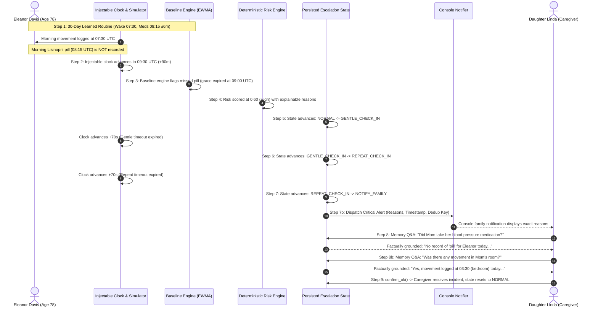

# CareLoop: Repeatable Demonstration & Simulator Guide

CareLoop provides an end-to-end, repeatable demonstration of proactive elder safety monitoring, deterministic baseline anomaly detection, staged voice escalation, console family notifications, and clinically grounded memory Q&A.

The core demonstration operates **100% locally** without requiring Amazon Bedrock credentials, real cellular SMS delivery, or physical Alexa hardware.

---

## 1. Single Command Quickstart

CareLoop features a unified demonstration orchestrator script (`scripts/run_demo.py`) that prepares an isolated demo database (`careloop_demo.db`), seeds realistic multi-day routine history, verifies or starts the FastMCP server, and runs or readies the simulation.

### Option A: Interactive Browser Demonstration (Recommended for Judges & Live Demos)

```bash
# Prepares isolated database, launches server, and opens the Simulator UI in your browser
python scripts/run_demo.py --interactive
```

- **Simulator UI**: [http://127.0.0.1:8000/simulator](http://127.0.0.1:8000/simulator)
- **MCP Endpoint**: `http://127.0.0.1:8000/mcp` (Streamable HTTP)
- **Isolated Database**: `careloop_demo.db` (SQLite)
- **One-Click Buttons**: Click **💊 Missed Meds Demo** or **🍲 Dad Skips Lunch Demo** in the top bar.

### Option B: Automated 9-Step Verification (3 Consecutive Clean Runs)

```bash
# Executes the complete 9-step safety sequence 3 times end-to-end via real backend MCP calls
python scripts/run_demo.py --auto --repeat 3
```

### Option C: Optional AWS Mode Preflight Verification (Explicitly Opt-In)

```bash
# Validates AWS credentials, DynamoDB table, SNS topic, and Bedrock model availability
python scripts/run_demo.py --aws
```

---

## 2. The 9-Step Core Demonstration Sequence

The demonstration follows Eleanor Davis (age 78) through an unattended missed medication incident:



### Sequence Step Details

1. **Learned Routine over Multiple Days**:
   Eleanor has 30+ days of routine history stored in `careloop_demo.db`. Her learned mean morning medication time is $\mu \approx 08:15\text{ UTC}$ with $\sigma \approx 6\text{ minutes}$. Her baseline grace window margin is 45 minutes (grace window ends at 09:00 UTC).
2. **Expected Medication Event Not Recorded**:
   On simulated date `2026-10-20`, morning movement is recorded in the bedroom at 07:30 UTC. The 08:15 AM prescription blood pressure medication (Lisinopril 10mg) is deliberately omitted.
3. **Injectable Clock Advances Beyond Grace Window**:
   The simulator advances the backend `SimulatedClock` to `09:30 UTC` (30 minutes past grace window expiration).
4. **Baseline Engine Identifies Missed Event**:
   `BaselineEngine.evaluate_routine("eleanor", "medication", now)` evaluates Eleanor's routine status and determines `is_missed=True` with `status="missed"`.
5. **Deterministic Risk Scoring Produces Explainable Result**:
   `RiskEngine.evaluate_person_risk()` calculates an elevated risk score ($0.60$, High Risk) grounded strictly in evidence:
   - *"Medication missed past baseline grace window (weight: 0.4)"*
   - *"Expected 'medication' around 08:15 UTC (sigma=6.0m). Grace window ended at 09:00 UTC (+45m grace). Current time is 09:30 UTC with no event recorded today."*
6. **Persisted Escalation State Advances Through Stages**:
   - `tick_escalation()` transitions state from `NORMAL` $\to$ `GENTLE_CHECK_IN`. Alexa issues a gentle voice prompt.
   - Advancing clock past configured gentle timeout (+70s) $\to$ `REPEAT_CHECK_IN`. Alexa emits an audible chime and repeat prompt.
   - Advancing clock past configured repeat timeout (+70s) $\to$ `NOTIFY_FAMILY`. Alert record is created and persisted in SQLite with `ACTIVE` status.
7. **Console Family Notification Displays Actual Reason**:
   `ConsoleNotifier` outputs structured, high-visibility family dispatch to `stdout` with recipient phone numbers, message, deterministic reasons, and deduplication key:
   ```
   =================================================================
   🚨 [CARELOOP FAMILY ALERT] Person: ELEANOR | Severity: CRITICAL
   Recipient(s): Linda Davis (+1-555-***-2834), Mark Davis (+1-555-***-5847)
   Message: Elder Care Alert: Eleanor Unresponsive to Routine Check-Ins
   Deterministic Reasons:
     • Expected 'medication' around 08:15 UTC (sigma=6.0m).
     • Grace window ended at 09:00 UTC (+45m grace).
     • Current time is 09:30 UTC with no event recorded today.
     • Gentle voice check-in timed out (60s).
     • Repeat voice check-in timed out (60s) with no response.
   Deduplication Key: escalation:eleanor:2026-10-20:unresponsive:critical
   =================================================================
   ```
8. **Caregiver Asks Grounded Memory Question**:
   Family caregiver asks: *"Did Mom take her blood pressure medication this morning?"*
   CareLoop's memory query executes against storage and returns an explainable answer with zero hallucinations:
   > *"There is no record of 'pill' for Eleanor Davis (Mom) today. (Note: A missing record indicates that no sensor or voice log was recorded; it does not confirm the event did not occur.)"*
   Caregiver asks: *"Was there any movement in Mom's room this morning?"*
   CareLoop retrieves the verified event and answers:
   > *"Yes, Eleanor Davis (Mom) logged movement (bedroom) at 03:30 America/New_York on 2026-10-20. A total of 1 matching event record(s) were found."*
9. **UI Shows Actual MCP Calls & Resolution**:
   Caregiver calls `confirm_ok(person="eleanor", note="Contacted Mom - confirmed safe, taking pill now")`.
   The escalation state machine authoritatively resets to `NORMAL`, and all active alerts are marked `RESOLVED`.
   The Simulator UI displays the actual MCP tool name, arguments, execution duration (ms), JSON response, and real-time state pill transitions.

---

## 3. Simulator UI Features & Status Displays

The CareLoop web simulator ([http://127.0.0.1:8000/simulator](http://127.0.0.1:8000/simulator)) provides a complete control cockpit:

### Live System Status Bar
Located at the top of the dashboard, showing real backend state polled every 3 seconds:
- **Demo Mode Pill**: `● DEMO MODE (Fast Timeouts: 60s / 60s)`
- **Clock**: `Simulated (09:30:00 UTC)`
- **Database**: `SQLITE (careloop_demo.db)`
- **Server**: `FastMCP 0.1.0 (/mcp)`
- **Notifier**: `ConsoleNotifier (stdout)`

### Configurable Escalation Timeouts
In production, voice escalation stages wait 15–30 minutes to give seniors time to respond. For live hackathon demonstrations, timeouts are configurable via environment variables or CLI flags:
- `CARELOOP_ESC_GENTLE_TIMEOUT=60` (Default: 60 seconds)
- `CARELOOP_ESC_REPEAT_TIMEOUT=60` (Default: 60 seconds)

### One-Click Scenario Triggers
- **💊 Missed Meds Demo**: Runs the complete 6-stage Eleanor missed medication scenario.
- **🍲 Dad Skips Lunch Demo**: Runs the Arthur Davis midday inactivity & skipped lunch scenario.
- **↺ Reset Demo Session**: Invokes `/api/demo/reset` to wipe only simulated events and active alerts, restoring the clock to `08:15 AM` while preserving all 30-day learned baseline profiles.

---

## 4. Optional AWS Mode Preflight Verification

CareLoop supports production deployment to AWS ECS Fargate, DynamoDB, Amazon SNS, and Amazon Bedrock. To verify cloud readiness without guessing credentials:

```bash
python scripts/run_demo.py --aws
```

### Preflight Checks Executed:
1. **AWS STS Caller Identity**: Confirms valid IAM credentials and displays Account ID and ARN.
2. **DynamoDB Table Access**: Verifies accessibility of `CareLoop-Events` table and key schema (`PK`, `SK`).
3. **Amazon SNS Topic Access**: Verifies publish permissions to `CareLoop-Alerts`.
4. **Bedrock Converse Model**: Checks connectivity to Anthropic Claude 3 Haiku (`anthropic.claude-3-haiku-20240307-v1:0`).

If cloud credentials are not configured, the script outputs actionable guidance and continues in local demo mode.

---

## 5. Troubleshooting Guide

| Problem | Cause | Solution |
| :--- | :--- | :--- |
| **Cannot connect to MCP server (HTTP 502 / Connection Refused)** | Server process not running or bound to wrong port. | Run `python scripts/run_demo.py` or `python -m careloop.server --port 8000 --clock simulated --db careloop_demo.db`. |
| **Browser Speech Recognition (Voice Input) inactive** | Web Speech API requires secure origin or browser mic permissions. | Use `http://localhost:8000` or `http://127.0.0.1:8000`. Grant microphone permission in Chrome. If using Firefox/Safari, use the text input or speech bubble triggers. |
| **HTTP 401 Unauthorized / Token Mismatch** | `ALEXA_AUTH_TOKEN` is configured on server but missing in client. | Click the **Alexa+ Auth** pill in the simulator header and paste the bearer token. |
| **Resetting stuck or unexpected escalation state** | State machine remained in `notify_family` from previous run. | Click **↺ Reset Demo Session** in the top status bar or call `POST /api/demo/reset`. |
| **Streamable HTTP (`/mcp`) connection dropped** | Corporate proxy or VPN stripping Server-Sent Events headers. | Disable proxy buffering for `/mcp` or use direct loopback `127.0.0.1:8000`. |

---

## 6. Verification Report: Automated vs. Manually Verified

### What Was Automated via `scripts/run_demo.py --auto --repeat 3`
1. **Clean Start Isolation**: Wiped demo events and reset escalation state before each run.
2. **Clock Manipulation**: Advanced injectable clock through grace window (+90m) and timeout intervals (+2m, +2m).
3. **Deterministic Anomaly Evaluation**: Verified baseline engine flagged `missed_medication` with risk score $0.60$.
4. **State Machine Transitions**: Verified state progressed `NORMAL` $\to$ `GENTLE_CHECK_IN` $\to$ `REPEAT_CHECK_IN` $\to$ `NOTIFY_FAMILY` $\to$ `NORMAL`.
5. **Idempotency & Deduplication**: Repeated ticks on `NOTIFY_FAMILY` produced **0 duplicate alerts** across all 3 runs.
6. **Alert Persistence**: Verified single `ACTIVE` alert with unique UUID and stable deduplication key.
7. **Grounded Memory Q&A**: Verified zero-record response for missed pill and positive log retrieval for morning movement.
8. **Incident Resolution**: Verified `confirm_ok` returned stage to `NORMAL` and marked active alerts resolved.

### What Was Manually Verified in Browser Simulator UI
1. **Visual State Pill Progression**: Observed step indicators dynamically lighting up as escalation progressed.
2. **Real MCP Call Inspector**: Inspected live tool name, arguments, status code, duration (ms), and JSON response.
3. **Simulated Family Phone**: Observed incoming simulated SMS alert card displaying exact reasons and timestamp.
4. **Browser Voice Input**: Tested speech transcription and audio text-to-speech feedback.
5. **Dark Mode & Warm Palette**: Verified contrast ratios and responsive layout on desktop and mobile viewports.
