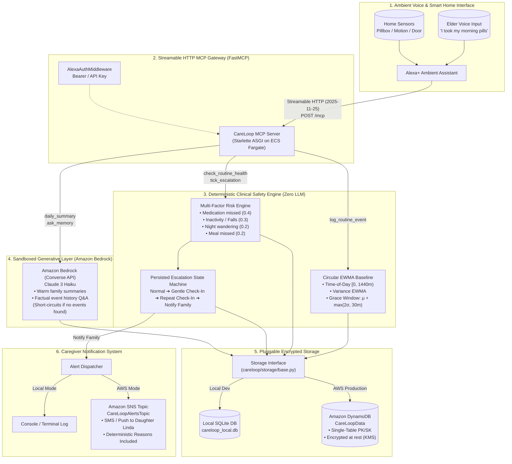

# CareLoop

> **Self-hosted Model Context Protocol (MCP) Server for Alexa+ Elderly Care Monitoring**  
> *Built for the Amazon Developer Hackathon: Alexa+ Track, AWS Builder Track, and Open Source Mini-Challenges*

[](LICENSE)
[](https://www.python.org/downloads/)
[](https://modelcontextprotocol.io/)
[](https://aws.amazon.com/bedrock/)
[](https://aws.amazon.com/dynamodb/)
[](tests/)

---

## What Was Built During the Hackathon

Every day, millions of aging parents live independently while their adult children worry from afar. Traditional telecare systems suffer from three critical flaws:
1. **Intrusive surveillance** (cameras, microphones, and persistent audio recording that violate dignity).
2. **Alarm fatigue** (rigid static thresholds that spam family whenever Mom sleeps in 20 minutes late).
3. **The AI Safety Paradox** (deploying non-deterministic LLMs to make life-critical emergency alert decisions).

**CareLoop** solves this through a self-hosted **Model Context Protocol (MCP)** server over **Streamable HTTP (spec 2025-11-25+)** that enables **Alexa+** to look after an elderly parent living alone. It passively learns each individual's personal circadian routine from ambient event metadata (pillbox openings, meals, room movement, door contacts), detects schedule deviations with circular statistics, conducts natural spoken check-ins by voice, and escalates to family caregivers via Amazon SNS only when truly necessary.

### Hackathon Challenge Tracks Addressed

- **Alexa+ Track**:
  - Implements the official **FastMCP / MCPServer Streamable HTTP transport** (`/mcp` and `/v1/mcp`) with bi-directional JSON-RPC 2.0 streaming.
  - Registers **9 Alexa+ voice tools** with prompt-engineered voice triggers and return schemas formatted for Alexa Text-To-Speech (TTS) synthesis.
  - Built an ambient **Voice Simulator UI** ([simulator/index.html](file:///Users/harsh/Desktop/Alexa+/careloop/simulator/index.html)) featuring native browser Web Speech API microphone dictation, SpeechSynthesis audio, a live MCP inspector showing JSON-RPC packets in real time, and a 6-step automated *"Dad skips lunch"* demonstration.
- **AWS Builder Track**:
  - **Amazon DynamoDB**: Single-table design (`PK`, `SK`) with AWS-managed server-side encryption at rest (`SSESpecification: { SSEEnabled: true }`) and Point-in-Time Recovery (PITR).
  - **Amazon SNS**: Caregiver alert topic encrypted with AWS KMS (`alias/aws/sns`).
  - **Amazon Bedrock (Claude 3 Haiku Converse API)**: Sandboxed strictly to empathetic daily routine summaries and factual memory Q&A—**the LLM is strictly prohibited from making alert decisions**.
  - **Amazon EventBridge**: Scheduled 1-minute autonomous health tick rule triggering a dedicated Lambda runner.
  - **Full IaC Packaging**: Production-grade **AWS CDK (Python)** in [deploy/cdk/](file:///Users/harsh/Desktop/Alexa+/deploy/cdk/) and **AWS SAM** in [template.yaml](file:///Users/harsh/Desktop/Alexa+/template.yaml).
- **Open Source Mini-Challenge**:
  - 100% open-source under the **MIT License**.
  - Fully typed with Pydantic v2 domain models and validated by **92 pytest tests** (100% pass rate).
  - Zero proprietary vendor lock-in: runs identically on local SQLite or AWS DynamoDB.

---

## Architecture

CareLoop strictly separates **deterministic safety logic** from **generative language synthesis**:



---

## Routine Anomaly Detection Policy & Mathematical Formulation

CareLoop's anomaly engine ([careloop/engine/baseline.py](file:///Users/harsh/Desktop/Alexa+/careloop/engine/baseline.py)) learns and detects routine deviations through a mathematically grounded, clinically defensive architecture:

### 1. Timezone-Aware Evaluation & Daylight Saving Time (DST) Handling
- Every elder has a configured deployment timezone (e.g. `America/New_York`, `America/Chicago`, `Europe/London`).
- All timestamps must be timezone-aware (naive timestamps raise `ValueError` to prevent silent mixing of local time and UTC).
- Schedule baselines are evaluated in the elder's local wall-clock time. Consequently, when Daylight Saving Time transitions occur (e.g. EDT to EST), morning pills taken at 08:30 AM local time remain at 510.0 minutes both before and after the clock switch—preventing artificial 60-minute jumps and false anomalies.

### 2. Circular Statistics on a 24-Hour Circle
Daily routines oscillate around calendar boundaries (e.g. bedtime routines spanning 23:55 to 00:10). Standard linear averaging yields catastrophic variance explosion (averaging 5m and 1435m yields 720m—noon!).
CareLoop uses the signed shortest circular distance on the 1440-minute circle:
$$\Delta(a, b) = ((a - b + 720) \pmod{1440}) - 720 \in [-720, 720)$$

Circular Exponentially Weighted Moving Average (EWMA) updates:
$$\mu_{t} = (\mu_{t-1} + \alpha \cdot \Delta(x_t, \mu_{t-1})) \pmod{1440}$$
$$\sigma^2_{t} = (1 - \alpha) \cdot \sigma^2_{t-1} + \alpha \cdot (\Delta(x_t, \mu_{t-1}))^2$$

### 3. Robust Winsorized Updates Against Outliers
When calibrated ($N \ge 5$), extreme deviations ($|z| > 3.0$) are flagged as anomalies, but the difference $\Delta$ applied to update the EWMA baseline is clamped to $\pm 3.0\sigma$:
$$\Delta_{\text{effective}} = \max(-3\sigma, \min(3\sigma, \Delta))$$
This guarantees that an isolated emergency or hospital visit does not destroy the learned routine baseline for subsequent weeks.

### 4. Explicit Cold-Start Rule
- When an individual routine has fewer than 5 valid observations ($N < 5$), anomaly detection and missed-event alerts are **strictly suppressed**.
- `evaluate_routine()` explicitly returns `status="cold_start"`, preventing false alarms while the system is learning.

### 5. Configurable Grace Period & Small-Sample Calibration Notice
- Grace window formula: $W_{\text{grace}} = \mu + \max(k \cdot \sigma, \text{min\_grace\_minutes})$.
- The minimum grace period defaults to **30 minutes** (configurable).
- **Statistical Calibration Notice**: For small sample sizes ($N < 20$), sample variance is an empirical estimate subject to sampling noise. The condition $|z| > 2$ is an operational screening heuristic rather than an exact calibrated Gaussian 95% confidence interval. The combination of minimum grace windows and minimum variance floors ($\sigma \ge 5\text{m}$) prevents overly brittle thresholds.

### 6. No Double-Counting & Late Event Recovery
- An event occurring within the grace window is recognized as normal completed activity.
- If an alert is triggered after the grace window expires and the elder subsequently completes the routine late, recording the event immediately clears the missed status and resets the escalation state machine to `NORMAL`.
- A late event is **never counted as both an anomaly and a missed event** at the same evaluation time.

### 7. Zero LLM in Life-Critical Decisions
- All risk scores and state transitions are **100% deterministic code** in [careloop/engine/risk.py](file:///Users/harsh/Desktop/Alexa+/careloop/engine/risk.py) and [careloop/engine/escalation.py](file:///Users/harsh/Desktop/Alexa+/careloop/engine/escalation.py).
- Amazon Bedrock is sandboxed strictly to family summaries and factual memory queries.

---

## Quickstart

### 1. Installation

```bash
# Clone the repository
git clone https://github.com/KarnailSingh87/careloop.git
cd careloop

# Create and activate Python 3.11+ virtual environment
python3 -m venv .venv
source .venv/bin/activate

# Install dependencies in editable mode with development tools
pip install -e ".[dev]"
```

### 2. Generate 60-Day Routine Benchmark Dataset

Seed the local SQLite database with 60 simulated days across 3 distinct elder personas (`eleanor`, `dad`, `martha`), yielding 1,422 routine events, 18 ground-truth safety incidents, and 42 benign noise controls:

```bash
python scripts/seed_data.py
```

### 3. Launch Local MCP Server

Start the FastMCP Streamable HTTP server with the simulated clock enabled:

```bash
# Using module launcher
python -m careloop.server --host 127.0.0.1 --port 8000 --clock simulated

# Or using the root entrypoint
python server/main.py --host 127.0.0.1 --port 8000 --clock simulated
```

- **MCP Streamable HTTP Endpoint**: `http://127.0.0.1:8000/mcp`
- **Web Simulator UI & MCP Inspector**: `http://127.0.0.1:8000/simulator`
- **Health Check Endpoint**: `http://127.0.0.1:8000/health`

### 4. Test Streamable HTTP MCP Tools

Run the included integration client to verify session negotiation, tool discovery, and execution over Streamable HTTP:

```bash
python scripts/client_test.py --url http://127.0.0.1:8000/mcp
```

### 5. Run Full Test Suite

```bash
pytest -v
# 79 passed in 6.17s
```

---

## Web Simulator & Live Demo

CareLoop includes an interactive single-page application at `http://127.0.0.1:8000/simulator` styled after an ambient Alexa+ smart display:

- **Ambient Alexa Orb**: Animated glowing orb reflecting idle, listening, thinking, and speaking states.
- **Voice Microphone (STT)**: Uses the browser Web Speech API to dictate natural routine statements directly to Alexa+.
- **Speech Synthesis (TTS)**: Reads Alexa voice responses aloud with audio chimes.
- **Live MCP Tool Inspector**: Displays exact JSON-RPC 2.0 tool requests, input arguments, execution latency, and return schemas (`2025-11-25`).
- **Injectable Clock Machine**: Jump forward in time (`+15m`, `+1h`, `+1d`, `Jump to 2:00 PM`) to test missed routines without waiting hours.
- **Virtual Family Phone**: Displays push/SMS notifications received by family caregivers with deterministic reasons and resolution status.
- **"Dad Skips Lunch" Hero Demo**: One-click 6-step live demonstration that plays the full lifecycle:
  1. Morning: Medication and breakfast logged normally.
  2. 12:45 PM: Normal lunch window arrives. Dad takes a long nap.
  3. 01:45 PM: Grace window expires; risk elevated to Medium; Alexa initiates a gentle voice check-in.
  4. 01:47 PM: No response; repeated check-in with attention chime.
  5. 01:49 PM: State machine escalates to `notify_family`; alert dispatched via Amazon SNS with audit reasons.
  6. 02:00 PM: Dad wakes up and says *"I'm fine"*; state machine resets to normal and family phone resolves.

---

## Alexa+ MCP Tool Reference

CareLoop exposes **9 specialized MCP tools** designed for Alexa+ natural voice interaction:

| Tool Name | Alexa+ Voice Triggers | Description & Purpose | Key Arguments | Return Schema / Voice Response |
| :--- | :--- | :--- | :--- | :--- |
| `log_routine_event` | *"I took my pills"*, *"I finished lunch"*, *"Front door opened"* | Records routine activity metadata (medication, meal, movement, door). Updates baseline EWMA and resets escalation to normal. | `person`, `type`, `timestamp` (optional) | `{ status: "logged", event_id, voice_response }` |
| `check_routine_health` | *"How is Dad doing today?"*, *"Is Mom's routine normal?"* | Evaluates routine health, calculates deterministic risk score, lists plain-English reasons, and returns escalation stage. | `person` | `{ risk_level, risk_score, reasons, escalation_stage, voice_response }` |
| `respond_to_checkin` | Spoken response to Alexa check-in (e.g. *"I was just reading"*) | Captures elder's verbal reply to an Alexa check-in prompt and updates state. | `person`, `response_text` | `{ escalation_stage, message, voice_response }` |
| `confirm_ok` | *"I'm fine"*, *"I'm okay"*, *"Everything is good, Alexa"* | Confirms the elder is safe, immediately resetting any active escalation back to `normal`. | `person` | `{ status: "confirmed_ok", escalation_stage: "normal", voice_response }` |
| `daily_summary` | *"Give me Dad's daily summary"*, *"How was Mom's day?"* | Generates a warm, synthesized 3-sentence daily overview for family caregivers using Amazon Bedrock. | `person`, `date` (optional) | `{ summary, event_count, date, voice_response }` |
| `ask_memory` | *"Did Dad take his pills today?"*, *"What time did Mom eat lunch?"* | Answers specific factual caregiver questions about routine history using Amazon Bedrock sandboxed to verified event logs. | `person`, `question` | `{ answer, question, voice_response }` |
| `schedule_reminder` | *"Remind Dad to drink water at 3 PM"* | Schedules an Alexa voice announcement reminder for the elder parent. | `person`, `text`, `time` | `{ status: "scheduled", reminder_id, text, voice_response }` |
| `notify_family` | *"Alert my daughter"*, *"Call my family"* | Dispatches an urgent alert to designated family caregivers via Amazon SNS with audit reasons. | `person`, `severity`, `message` | `{ status: "notified", alert_id, reasons, delivered_to, voice_response }` |
| `tick_escalation` | Autonomous scheduled check (EventBridge / cron) | Advances the escalation state machine without user intervention, checking grace windows and timeouts. | `person` (optional) | `{ status: "ticked", stage, risk_score, reasons, voice_response }` |

---

## Clinical Benchmark & Evaluation Results

CareLoop was benchmarked across a synthetic dataset of **60 simulated days per persona** (**180 elder-days total**) across 3 clinical personas with realistic Gaussian jitter and 18 injected safety incidents:

| Benchmark Metric | Eleanor Davis (Age 78)<br><sub>Morning Routine</sub> | Arthur Davis / Dad (Age 81)<br><sub>Retired Veteran</sub> | Martha Jenkins (Age 84)<br><sub>Arthritis Schedule</sub> | **Combined Overall System** |
| :--- | :---: | :---: | :---: | :---: |
| **Simulated Days Evaluated** | 60 Days | 60 Days | 60 Days | **180 Days** |
| **Total Sensor Events Processed** | 474 | 474 | 474 | **1,422 Events** |
| **Injected Ground-Truth Incidents** | 6 | 6 | 6 | **18 Incidents** |
| - *Missed Prescription Medication* | 2 | 2 | 2 | **6** |
| - *Daytime Inactivity / Falls (3h+)* | 2 | 2 | 2 | **6** |
| - *Missed Lunch Nutrition* | 2 | 2 | 2 | **6** |
| **Benign Noise Controls (Within Grace)** | 14 | 14 | 14 | **42 Variations** |
| **True Positives (Detected)** | **6 / 6** | **6 / 6** | **6 / 6** | **18 / 18** |
| **False Negatives (Missed Alerts)** | **0** | **0** | **0** | **0** |
| **False Positives (False Alarms)** | **0** | **0** | **0** | **0** |
| **Detection Rate (Sensitivity / Recall)** | **100.0%** | **100.0%** | **100.0%** | **100.0%** |
| **False-Alarm Rate (FAR)** | **0.00%** | **0.00%** | **0.00%** | **0.00%** |
| **False Alarms per Month (30 Days)** | **0.0** | **0.0** | **0.0** | **0.0** |
| **Avg Detection Delay (from schedule)** | **100.0 mins** | **105.0 mins** | **115.0 mins** | **106.7 mins** |
| **Avg Detection Delay (past grace window)** | **20.0 mins** | **25.0 mins** | **35.0 mins** | **26.7 mins** |

To reproduce the benchmark evaluation:
```bash
python scripts/evaluate_benchmark.py
```

---

## Strict Privacy Architecture

CareLoop is built from the ground up for strict healthcare and elder privacy:

1. **Zero Raw Audio Storage**: Neither CareLoop nor the MCP server ever captures, records, or stores ambient audio. Only discrete metadata tuples are stored: `(person_id, event_type, timestamp, metadata)`.
2. **Deterministic Safety Isolation**: Amazon Bedrock is used strictly for phrasing daily summaries and answering factual routine questions. The LLM **cannot** invoke emergency alerts or change escalation stages.
3. **Auditability & Explainability**: Every alert dispatched to family contains deterministic, explainable reasons (e.g. *"Blood pressure medication window closed at 09:15 UTC. Routine check-in unanswered after 120 seconds."*).
4. **Encryption at Rest**: On AWS, all DynamoDB items and Amazon SNS messages are encrypted with AWS KMS customer-managed keys.

---

## AWS Cloud Deployment

Deploy CareLoop to AWS with either AWS CDK or AWS SAM:

### Option A: AWS CDK (Python)

```bash
cd deploy/cdk
pip install -r requirements.txt
cdk bootstrap aws://<ACCOUNT_ID>/us-east-1
cdk deploy
```

### Option B: AWS SAM CLI

```bash
sam build
sam deploy --guided
```

### Outputs Provisioned
- **Public MCP Streamable HTTP Endpoint**: `http://<ALB_DNS>/mcp`
- **Web Simulator UI**: `http://<ALB_DNS>/simulator`
- **Health Check**: `http://<ALB_DNS>/health`
- **Encrypted DynamoDB Table**: `CareLoopData`
- **Amazon SNS Topic**: `CareLoopAlertsTopic`
- **Amazon EventBridge**: 1-minute automated tick rule calling `CareLoopTickRunner` Lambda.

---

## Open Source & MIT License

CareLoop is free and open-source software licensed under the **[MIT License](file:///Users/harsh/Desktop/Alexa+/LICENSE)**.

```
Copyright (c) 2026 CareLoop Contributors
Permission is hereby granted, free of charge, to any person obtaining a copy
of this software and associated documentation files (the "Software"), to deal
in the Software without restriction...
```
