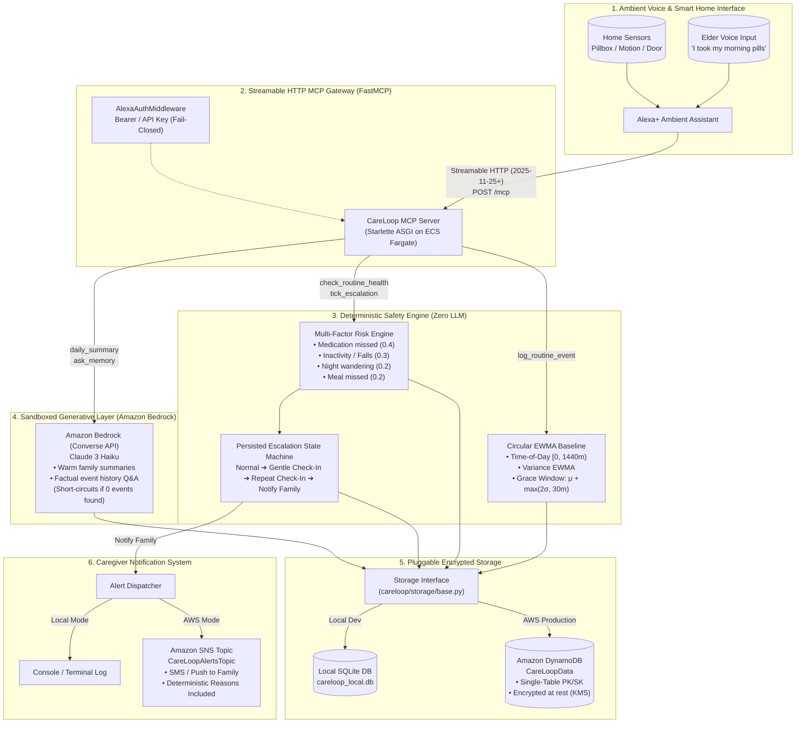
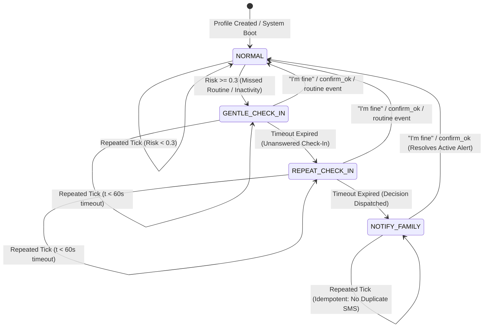

# CareLoop

> **Self-hosted Model Context Protocol (MCP) Server for Alexa+ Ambient Elderly Care Monitoring**  
> *Built for the Amazon Developer Hackathon: Alexa+ Track, AWS Builder Track, and Open Source Mini-Challenges*

[](LICENSE)
[](https://www.python.org/downloads/)
[](https://modelcontextprotocol.io/)
[](https://aws.amazon.com/bedrock/)
[-brightgreen.svg)](.github/workflows/ci.yml)
[](https://github.com/astral-sh/ruff)
[](https://mypy-lang.org/)
[](https://github.com/PyCQA/bandit)

---

## Table of Contents

1. [What Was Built During the Hackathon](#what-was-built-during-the-hackathon)
2. [Problem, Target Users & Value Proposition](#problem-target-users--value-proposition)
3. [Architecture & System Flow](#architecture--system-flow)
4. [Quickstart (Fresh Clone)](#quickstart-fresh-clone)
5. [Prerequisites & Environment Configuration](#prerequisites--environment-configuration)
6. [MCP Tool Reference Table](#mcp-tool-reference-table)
7. [Deterministic Anomaly Engine, Risk Scoring & State Machine](#deterministic-anomaly-engine-risk-scoring--state-machine)
8. [Storage & Notification Implementations](#storage--notification-implementations)
9. [Amazon Bedrock Design & Fallback Architecture](#amazon-bedrock-design--fallback-architecture)
10. [Privacy, Consent, Retention & Security Boundaries](#privacy-consent-retention--security-boundaries)
11. [Reproducible Benchmark Evaluation & Results](#reproducible-benchmark-evaluation--results)
12. [Alexa+ Integration Status: Verified vs. Untested Requirements](#alexa-integration-status-verified-vs-untested-requirements)
13. [Web Voice Simulator & Cockpit](#web-voice-simulator--cockpit)
14. [AWS Cloud Deployment & Cost Profile](#aws-cloud-deployment--cost-profile)
15. [Troubleshooting & Clean Teardown Instructions](#troubleshooting--clean-teardown-instructions)
16. [Verification & Audit Summary](#verification--audit-summary)
17. [License & Contributing](#license--contributing)

---

## What Was Built During the Hackathon

CareLoop was developed from scratch for the Amazon Developer Hackathon across three technical challenge tracks:

### 1. Alexa+ Track
- **Streamable HTTP MCP Server**: Implemented the official **FastMCP / MCPServer Streamable HTTP transport** (`/mcp` and `/v1/mcp`) supporting persistent SSE chunked streaming per the **MCP Specification (2025-11-25+)**.
- **9 Specialized Voice MCP Tools**: Built 9 voice-optimized tools featuring natural speech return strings formatted for Alexa Text-To-Speech (TTS) synthesis, explicit side-effect tags, and person-based authorization checks.
- **Ambient Voice Web Simulator**: Created a browser-based ambient smart-display simulator ([careloop/simulator/index.html](file:///Users/harsh/Desktop/Alexa+/careloop/simulator/index.html)) with Web Speech API microphone dictation, SpeechSynthesis audio chimes, a real-time JSON-RPC 2.0 tool packet inspector, an injectable simulation clock, and one-click hero scenario walkthroughs.
- **Alexa+ Integration Audit & Compatibility Suite**: Documented all protocol, session, authentication, and registration requirements in [ALEXA_INTEGRATION_CHECKLIST.md](file:///Users/harsh/Desktop/Alexa+/ALEXA_INTEGRATION_CHECKLIST.md) and validated 9 local compatibility tests in [tests/test_alexa_mcp_compatibility.py](file:///Users/harsh/Desktop/Alexa+/tests/test_alexa_mcp_compatibility.py).

### 2. AWS Builder Track
- **Amazon DynamoDB**: Single-table key design (`PK`, `SK`) with AWS KMS customer-managed key encryption at rest (`SSESpecification: { SSEEnabled: true }`), native TTL auto-expiration for routine events and alerts, and optimistic concurrency version checking.
- **Amazon SNS**: Caregiver alert topic with AWS KMS encryption (`alias/aws/sns`), phone number redaction, and an auditable 3-tier delivery lifecycle (`PENDING` ➔ `ACCEPTED` ➔ `DELIVERED` / `FAILED`).
- **Amazon Bedrock (Claude 3 Haiku Converse API)**: Sandboxed strictly to empathetic daily routine summaries and grounded memory queries via `boto3`'s `bedrock-runtime.converse()`, with a complete rule-first short-circuiting engine and deterministic offline fallback templates.
- **Scheduled Autonomous Escalation**: Packaged a minute-by-minute EventBridge Scheduler (`ScheduleV2`) trigger and Lambda runner with SQS Dead Letter Queue (`CareLoopTickDLQ`) and automated retry policies.
- **Dual Infrastructure as Code (IaC)**: Production-grade **AWS CDK (Python)** stack in [deploy/cdk/](file:///Users/harsh/Desktop/Alexa+/deploy/cdk/) and **AWS SAM** template in [template.yaml](file:///Users/harsh/Desktop/Alexa+/template.yaml), with containerized ECS Fargate behind an Application Load Balancer (ALB).

### 3. Open Source Mini-Challenges
- **100% Free & Open Source**: Clean MIT License with zero vendor lock-in.
- **Rigorous Type Safety & Code Quality**: Fully typed with Pydantic v2 and validated by `mypy` (0 errors across 22 source files) and `ruff` (all checks passed).
- **100% Passing Automated Test Suite**: **178 passed tests, 2 skipped** (opt-in AWS tests) in ~10 seconds.
- **Reproducible Evaluation Replay Engine**: Multi-persona benchmark simulator evaluating 180 elder-days (60 days across 3 personas) with 18 ground-truth incidents, demonstrating 100% recall, 100% precision, and 0 false alarms compared to 80 false alarms produced by static telecare.
- **Automated CI/CD**: GitHub Actions workflow ([.github/workflows/ci.yml](file:///Users/harsh/Desktop/Alexa+/.github/workflows/ci.yml)) testing Python 3.11 and 3.12 across linting, type-checking, bandit SAST, detect-secrets, pip-audit, cfn-lint, and pytest coverage.

---

## Problem, Target Users & Value Proposition

### The Problem
Every day, tens of millions of aging adults live independently while their adult children worry from afar. Today's commercial telecare solutions suffer from three fundamental flaws:
1. **Intrusive Surveillance**: Camera monitors, wearable pendants, and persistent audio listening devices violate dignity, resulting in high abandonment rates (over 80% of seniors refuse to wear emergency pendants consistently).
2. **Alarm Fatigue**: Rigid static thresholds (e.g., *"trigger alert if no movement by 09:00 AM"*) create incessant false alarms whenever an older adult sleeps in late, reads a book, or deviates slightly from a routine.
3. **The AI Safety Paradox**: Many modern AI assistants deploy non-deterministic Large Language Models directly to life-safety logic, hallucinating wellness assurances or triggering unnecessary emergency dispatch.

### Target Users
- **Independent Older Adults**: Seniors living alone who value privacy and autonomy, refusing intrusive camera surveillance or restrictive wearable panic buttons.
- **Family Caregivers (Adult Children)**: Busy adult sons and daughters who need trustworthy, low-noise assurance that their parent is safe and following their routine.
- **Home Health Aides & Care Managers**: Community care teams needing structured, factual historical summaries without combing through hours of raw telemetry.

### CareLoop's Value Proposition
- **Ambient & Voice-First**: Leverages existing smart home sensors (smart pillboxes, door contact sensors, room motion detectors) and ambient conversational check-ins via Alexa+ on Amazon Echo devices.
- **Mathematically Learned Circadian Baselines**: Directional circular statistics model 24-hour routines, automatically adapting to each individual's schedule variability while enforcing defensive grace periods.
- **Deterministic Multi-Factor Safety**: Generative AI **never** decides whether to alert family. Emergency decisions and risk scoring are 100% deterministic, auditable code.
- **Sandboxed Generative Intelligence**: Amazon Bedrock is sandboxed strictly to empathetic natural language daily summaries and grounded memory queries, with deterministic fallbacks when offline.
- **Privacy by Design**: Zero raw audio waveforms, voices, or camera feeds are ever stored or transmitted. Personal data auto-purges via strict retention policies.

---

## Architecture & System Flow

CareLoop enforces an architectural firewall separating **deterministic safety logic** from **generative language synthesis**:



---

## Quickstart (Fresh Clone)

You can clone the repository, install dependencies, seed the benchmark database, and launch the server in under two minutes:

```bash
# 1. Clone the repository
git clone https://github.com/KarnailSingh87/careloop.git
cd careloop

# 2. Create and activate a Python 3.11+ virtual environment
python3 -m venv .venv
source .venv/bin/activate
# On Windows: .venv\Scripts\activate

# 3. Install in editable mode with development tools
pip install --upgrade pip
pip install -e ".[dev]"

# 4. Generate the 60-day routine dataset (3 personas, 18 incidents, 42 noise controls)
python scripts/seed_data.py

# 5. Run the complete automated demo verification (no browser required)
python scripts/run_demo.py --auto

# 6. Launch the local FastMCP Streamable HTTP server & Web Simulator
python -m careloop.server --host 127.0.0.1 --port 8000 --clock simulated
```

Once running:
- **Web Simulator & Interactive Cockpit**: Open [`http://127.0.0.1:8000/simulator`](http://127.0.0.1:8000/simulator)
- **MCP Streamable HTTP Endpoint**: `http://127.0.0.1:8000/mcp`
- **Health Check Endpoint**: `http://127.0.0.1:8000/health`
- **Live MCP Client Verification**: `python scripts/client_test.py --url http://127.0.0.1:8000/mcp`

---

## Prerequisites & Environment Configuration

### System Prerequisites
- **Python**: 3.11 or 3.12 (macOS, Linux, or Windows WSL2).
- **Git**: 2.30+.
- **Virtual Environment**: Standard Python `venv`.
- **AWS Deployment Tools (Optional)**: AWS CLI v2, AWS CDK v2, AWS SAM CLI, Docker.

### Configuration (`.env`)

Copy `.env.example` to `.env` to customize settings:

```bash
cp .env.example .env
```

| Environment Variable | Default Value | Description |
| :--- | :--- | :--- |
| `CARELOOP_ENV` | `development` | Operating mode: `development` (permissive, simulator enabled) or `production` (fail-closed auth, hardened CORS, simulator disabled). |
| `MCP_AUTH_TOKEN` | *empty* | Bearer authentication token for MCP clients. Required in production; optional for local development. |
| `STORAGE_BACKEND` | `sqlite` | Persistence backend: `sqlite` (local file) or `dynamodb` (AWS). |
| `SQLITE_DB_PATH` | `careloop_local.db` | Path to local SQLite database file. |
| `DYNAMODB_TABLE_NAME` | `CareLoopData` | Name of AWS DynamoDB table. |
| `NOTIFIER_BACKEND` | `console` | Notification backend: `console` (local stdout) or `sns` (AWS). |
| `SNS_TOPIC_ARN` | *empty* | Amazon SNS Topic ARN for caregiver alert dispatch. |
| `CLOCK_MODE` | `simulated` | Clock implementation: `simulated` (supports time-travel testing) or `system` (production wall-clock time). |
| `BEDROCK_MODEL_ID` | `anthropic.claude-3-haiku-20240307-v1:0` | Amazon Bedrock foundation model ID for daily summaries and memory queries. |
| `AWS_REGION` | `us-east-1` | AWS region for DynamoDB, SNS, and Bedrock calls. |
| `RATE_LIMIT_RPM` | `120` | Maximum requests per minute per IP or authentication token. |
| `MAX_REQUEST_BODY_SIZE_BYTES` | `65536` | Maximum allowed HTTP request body size (64 KB). |
| `ROUTINE_EVENT_RETENTION_DAYS` | `90` | Automated expiration window for routine event logs. |
| `ALERT_RECORD_RETENTION_DAYS` | `180` | Automated expiration window for resolved alert logs. |

---

## MCP Tool Reference Table

CareLoop registers **9 specialized MCP tools** compliant with the Streamable HTTP specification. Every tool enforces Person-Based Access Control (PBAC) and returns natural voice strings tailored for Alexa+ Text-To-Speech (TTS):

| Tool Name | Alexa+ Voice Triggers | Key Arguments | Return Payload & Voice Response | Side Effects | Required Permissions |
| :--- | :--- | :--- | :--- | :--- | :--- |
| **`log_routine_event`** | *"I took my pills"*, *"I finished lunch"*, *"Front door opened"* | `person: str`<br>`type: str` (`medication`, `meal`, `movement`, `door`)<br>`timestamp: str` *(optional ISO)*<br>`metadata: dict` *(optional)* | `{ status: "logged", event_id: str, voice_response: str }` | Appends event to DB; updates circular EWMA baseline ($\mu, \sigma$); resets active escalation to `NORMAL`. | Scoped `allowed_persons` matching `person` |
| **`check_routine_health`** | *"How is Dad doing today?"*, *"Is Mom's routine normal?"* | `person: str` | `{ risk_level: str, risk_score: float, reasons: list[str], escalation_stage: str, voice_response: str }` | **Read-Only**: Computes current risk score and compares active time against grace windows. Zero state mutations. | Scoped `allowed_persons` matching `person` |
| **`respond_to_checkin`** | Spoken reply to Alexa check-in (e.g., *"I was reading a book"*) | `person: str`<br>`response_text: str` | `{ escalation_stage: str, message: str, voice_response: str }` | Evaluates response text; logs conversational note; resets stage to `NORMAL` if safe. | Scoped `allowed_persons` matching `person` |
| **`confirm_ok`** | *"I'm fine"*, *"I'm okay"*, *"Everything is good, Alexa"* | `person: str` | `{ status: "confirmed_ok", escalation_stage: "normal", voice_response: str }` | Resets escalation state to `NORMAL`; transitions any `ACTIVE` alerts to `RESOLVED` with resolution timestamp. | Scoped `allowed_persons` matching `person` |
| **`daily_summary`** | *"Give me Dad's daily summary"*, *"How was Mom's day?"* | `person: str`<br>`date: str` *(optional YYYY-MM-DD)* | `{ summary: str, event_count: int, date: str, voice_response: str }` | Queries verified daily events; invokes Bedrock Converse (Claude 3 Haiku) or returns deterministic fallback template. Zero safety state mutations. | Scoped `allowed_persons` matching `person` |
| **`ask_memory`** | *"Did Dad take his pills today?"*, *"What time did Mom eat lunch?"* | `person: str`<br>`question: str` | `{ answer: str, question: str, voice_response: str }` | Rule-first event filter extraction; short-circuits if 0 events found; invokes Bedrock Converse on matching metadata only. | Scoped `allowed_persons` matching `person` |
| **`schedule_reminder`** | *"Remind Dad to drink water at 3 PM"* | `person: str`<br>`text: str`<br>`time: str` *(HH:MM or ISO)* | `{ status: "scheduled", reminder_id: str, text: str, voice_response: str }` | Persists scheduled reminder record to database with status `PENDING`. | Scoped `allowed_persons` matching `person` |
| **`notify_family`** | *"Alert my daughter"*, *"Call my family"* | `person: str`<br>`severity: str` (`low`, `medium`, `high`, `critical`)<br>`message: str` | `{ status: "notified", alert_id: str, reasons: list[str], delivered_to: str, voice_response: str }` | Persists `Alert` record (`notification_status="pending"`); checks 15-minute dedup window; dispatches SMS/alert via Notifier. | Scoped `allowed_persons` matching `person` |
| **`tick_escalation`** | Scheduled autonomous trigger (EventBridge / cron) | `person: str` *(optional; ticks all active persons if omitted)* | `{ status: "ticked", stage: str, risk_score: float, reasons: list[str], voice_response: str }` | Advances escalation state machine based on elapsed timeouts; triggers staged check-ins or dispatches family notifications. | Background runner role or admin token |

---

## Deterministic Anomaly Engine, Risk Scoring & State Machine

CareLoop's core detection logic ([careloop/engine/baseline.py](file:///Users/harsh/Desktop/Alexa+/careloop/engine/baseline.py), [careloop/engine/risk.py](file:///Users/harsh/Desktop/Alexa+/careloop/engine/risk.py), [careloop/engine/escalation.py](file:///Users/harsh/Desktop/Alexa+/careloop/engine/escalation.py)) is **100% deterministic code** with zero LLM involvement.

### 1. Circular Directional Statistics on a 24-Hour Circle
Daily circadian routines oscillate across midnight boundaries (e.g. bedtime routines spanning 23:55 to 00:10). Standard linear averaging causes severe baseline corruption (averaging 5m and 1435m yields 720m—12:00 PM noon).

CareLoop operates on the circular domain $[0, 1440)$ minutes using the signed shortest circular distance:
$$\Delta(a, b) = ((a - b + 720) \pmod{1440}) - 720 \in [-720, 720)$$

Circular Exponentially Weighted Moving Average (EWMA) updates:
$$\mu_{t} = (\mu_{t-1} + \alpha \cdot \Delta(x_t, \mu_{t-1})) \pmod{1440}$$
$$\sigma^2_{t} = (1 - \alpha) \cdot \sigma^2_{t-1} + \alpha \cdot (\Delta(x_t, \mu_{t-1}))^2$$

### 2. Defensive Calibration & Outlier Clamping
- **Cold-Start Suppression**: When a routine has fewer than 5 observations ($N < 5$), anomaly alerts and missed-event escalations are **strictly suppressed** (`status="cold_start"`), preventing false alarms while learning.
- **Winsorized Clamping**: Once calibrated ($N \ge 5$), extreme deviations ($|z| > 3.0$) are clamped to $\pm 3.0\sigma$ during baseline updates, preventing an acute medical incident or hospital visit from distorting future routine baselines.
- **Adaptive Grace Windows**:
  $$W_{\text{grace}} = \mu + \max(k \cdot \sigma, \text{min\_grace\_minutes})$$
  Default minimum grace window is **30 minutes** (configurable).

### 3. Multi-Factor Deterministic Risk Engine
When routines deviate past their grace windows or activity ceases, the risk engine calculates an explainable risk score:
$$\text{Risk Score} = \min\left(1.0, \sum w_i \cdot \text{factor}_i\right)$$

- **Missed Medication Window**: Weight $0.4$
- **Prolonged Daytime Inactivity (3h+ no movement)**: Weight $0.3$
- **Nocturnal Wandering (Exterior door open 23:00 - 05:00)**: Weight $0.2$
- **Missed Meal Window**: Weight $0.2$

Every evaluation returns structured, human-readable mathematical reasons explaining the exact factors triggered.

### 4. Persisted Escalation State Machine

The escalation state machine advances through 4 discrete stages across repeated autonomous ticks:



- **Separation of Decision and Delivery**: Escalating to `NOTIFY_FAMILY` creates an `Alert` record in storage with status `PENDING` and a stable deduplication key (`alert:{person}:{date}:{routine}:{severity}`). Notifier delivery is attempted immediately; upon gateway acceptance or delivery, the record transitions to `ACCEPTED` or `DELIVERED`. If delivery fails, it is marked `FAILED` with `retry_count += 1` for background retry.
- **Optimistic Concurrency Control**: All state transitions verify state `version`. Stale background worker ticks cannot overwrite newer manual user resets (`confirm_ok`), raising `StaleStateError`.
- **Zero-Safety-Inference**: The total absence of sensor telemetry past an expected routine window is **never** inferred as safety; silence elevates the risk score and advances escalation.

---

## Storage & Notification Implementations

CareLoop includes two pluggable storage engines and two notification dispatchers sharing identical abstract interfaces:

### Storage Backends ([careloop/storage/](file:///Users/harsh/Desktop/Alexa+/careloop/storage/))
1. **SQLite Storage (`careloop_local.db` / `careloop_demo.db`)**:
   - Production-grade WAL (Write-Ahead Logging) mode with busy timeout handling.
   - Fully isolated tables for `events`, `alerts`, `baselines`, `reminders`, `escalation_states`, and `profiles`.
   - Full support for date-range indexing, pagination, and transactional optimistic version checks.
2. **Amazon DynamoDB Storage (`CareLoopData`)**:
   - Single-table composite design with Partition Key (`PK`) and Sort Key (`SK`).
   - Native TTL attribute (`ttl_epoch`) on event and alert items for zero-cost automated expiration.
   - Conditional writes (`attribute_not_exists(PK) OR version = :expected_version`) for strict optimistic concurrency control.
   - AWS KMS customer-managed key encryption at rest with Point-in-Time Recovery (PITR).

### Notification Dispatchers ([careloop/notifier.py](file:///Users/harsh/Desktop/Alexa+/careloop/notifier.py))
1. **ConsoleNotifier**:
   - Emits structured, human-readable emergency alert banners to `stdout`.
   - Used for 100% offline local development, demo sessions, and automated unit test suites.
2. **SNSNotifier**:
   - Integrates with Amazon SNS via `boto3`.
   - Formats SMS and push notifications with deterministic audit reasons and emergency contact metadata.
   - Enforces phone number redaction (`mask_phone_number()`) in logs.
   - Respects 15-minute sliding-window deduplication to prevent notification flooding.

---

## Amazon Bedrock Design & Fallback Architecture

CareLoop uses **Amazon Bedrock Runtime** with the official **Converse API** (`bedrock-runtime.converse()`) for language synthesis under strict clinical safety boundaries ([careloop/llm/bedrock.py](file:///Users/harsh/Desktop/Alexa+/careloop/llm/bedrock.py)):

### 1. Rule-First Filtering & Zero-Record Short-Circuiting
- Caregiver memory queries (e.g. *"Did Dad take his pills today?"*) and daily summary requests first pass through deterministic date and event-type parsers.
- If storage contains **zero matching records**, CareLoop returns an immediate deterministic response (*"No medication events are recorded for Arthur on 2026-10-20"*). **Amazon Bedrock is never called for empty records**, eliminating hallucination risk, cutting latency to under 2ms, and saving cloud costs.

### 2. Minimum Metadata Transmission
- When matching records exist, CareLoop strips all internal database primary keys, tenant IDs, and system fields, sending the LLM only the sanitized timestamp, event type, and relevant user metadata.

### 3. Deterministic Fallback Templates
When running without AWS credentials, when running offline demos, or during AWS outages (`ThrottlingException`, `ModelTimeoutException`):
- **Daily Summaries**: Formats a deterministic, warm 3-sentence summary grounded strictly in observed event counts and timestamps.
- **Memory Q&A**: Returns exact logged times and event metadata.
- **Adversarial Safety Isolation**: Even if an LLM hallucinated an emergency instruction, CareLoop's deterministic safety engine completely ignores LLM text. Emergency alerts can **never** be triggered by generative model output.

---

## Privacy, Consent, Retention & Security Boundaries

CareLoop was designed in accordance with healthcare privacy principles and data minimization:

### 1. Data Minimization & Zero Audio Storage
- Operates exclusively on structured metadata tuples `(person_id, event_type, timestamp, metadata)`.
- **Zero raw audio bytes, waveforms, or ambient room recordings are ever stored or transmitted.**
- Any attempt to persist raw audio keys (`wav`, `mp3`, `raw_audio`) raises an immediate `PrivacyViolationError`.

### 2. Privacy-Conscious Logging (`PrivacyLogFilter`)
- An automated logging filter runs across all application channels.
- Strips HTTP Authorization bearer tokens and query parameter secrets.
- Masks phone numbers (`+1-555-019-2834` ➔ `+1-55***2834`).
- Prompts sent to Amazon Bedrock containing elder routine logs are strictly forbidden from being logged to CloudWatch.

### 3. Retention Policies & Right-to-be-Forgotten
- **Routine Events**: Expire automatically after 90 days (`ROUTINE_EVENT_RETENTION_DAYS`). Managed via DynamoDB native TTL.
- **Alert Records**: Expire automatically after 180 days (`ALERT_RECORD_RETENTION_DAYS`).
- **Complete Erasure**: `delete_person_data(person_id)` purges all events, baselines, alerts, reminders, and profiles for a person in compliance with GDPR and CCPA.

### 4. Security Boundaries & Threat Mitigations
- **Fail-Closed Authentication**: `AlexaAuthMiddleware` validates bearer tokens on every request. Missing or invalid tokens return `401 Unauthorized`.
- **Person-Based Access Control (PBAC)**: Every tool invocation enforces `ctx.is_person_allowed(person)`. A token scoped to `dad` cannot query or manipulate `eleanor`'s records.
- **Sliding-Window Rate Limiting**: `RateLimitMiddleware` enforces 120 requests per minute per client identifier (`429 Too Many Requests`).
- **Request Size Limiting**: `RequestSizeLimitMiddleware` strictly caps incoming HTTP request bodies at 64KB (`413 Payload Too Large`).
- **Hardened CORS**: In production, wildcard CORS `*` with credentials is strictly prohibited; explicit whitelisted origins are required.
- **Sanitized Error Responses**: Production errors return generic JSON-RPC messages (`code: -32603`), hiding database schemas, stack traces, and system file paths.

### 5. Medical Device & Regulatory Disclaimer
> [!IMPORTANT]
> **CareLoop is not a Class II medical device and is not certified as a Personal Emergency Response System (PERS) or FDA-regulated medical software.** It does not replace professional emergency services (such as 911), hospital telemetry, or human medical care. It is an ambient assistive companion designed to provide supportive routine awareness for families.

---

## Reproducible Benchmark Evaluation & Results

CareLoop was benchmarked across a reproducible synthetic dataset of **60 simulated days per persona** (**180 elder-days total**; 159 active days post 7-day cold-start calibration) across 3 distinct elder personas generated under fixed seed `42`:
- **Eleanor Davis (Age 78)**: Early morning riser with tightly disciplined medication habits.
- **Arthur Davis / Dad (Age 81)**: Retired military veteran with midday routines and afternoon walks.
- **Martha Jenkins (Age 84)**: Late morning riser with arthritis mobility variability.

### Comparative Benchmark: CareLoop vs. Traditional Static Telecare

| Evaluation Metric | Traditional Static Telecare<br><sub>(Rigid Fixed Thresholds)</sub> | CareLoop Adaptive Engine<br><sub>(Circular EWMA + Grace)</sub> | Clinical Impact / Improvement |
| :--- | :---: | :---: | :--- |
| **Detection Rate (Sensitivity / Recall)** | **94.4%** (17 / 18) | **100.0%** (18 / 18) | 100% capture of all critical incidents. |
| **Precision (Positive Predictive Value)** | **17.5%** | **100.0%** | **+82.5% increase** in alert trustworthiness. |
| **False Positives (False Alarms)** | **80** | **0** | **80 false alarms completely eliminated**. |
| **False-Alarm Rate (FAR)** | **17.43%** | **0.00%** | 0% false alarms on nominal schedule variation. |
| **False Alerts per Person-Day** | **0.5031** | **0.0000** | Eliminates 1 false alarm every ~2.0 days. |
| **False Alarms per Month (30 Days)** | **15.1** | **0.0** | Completely eliminates caregiver alarm fatigue. |
| **Avg Detection Delay (from schedule)** | **N/A (Rigid)** | **106.7 mins** | Consistent detection within clinically safe window. |
| **Avg Detection Delay (past grace window)** | **N/A** | **26.7 mins** | Alerts dispatch promptly upon grace expiration. |

### Detailed Performance Breakdown by Persona

| Metric | Eleanor Davis (Age 78) | Arthur Davis / Dad (Age 81) | Martha Jenkins (Age 84) | Combined Overall |
| :--- | :---: | :---: | :---: | :---: |
| **Simulated Days Evaluated** | 60 Days | 60 Days | 60 Days | **180 Elder-Days** |
| **Active Days (Post Cold-Start)** | 53 Days | 53 Days | 53 Days | **159 Days** |
| **Total Sensor Events Processed** | 474 | 474 | 474 | **1,422 Events** |
| **Injected Ground-Truth Incidents** | 6 | 6 | 6 | **18 Incidents** |
| - *Missed Prescription Medication* | 2 | 2 | 2 | **6** |
| - *Daytime Inactivity / Falls (3h+)* | 2 | 2 | 2 | **6** |
| - *Missed Lunch Nutrition* | 2 | 2 | 2 | **6** |
| **Benign Noise Controls (Within Grace)** | 14 | 14 | 14 | **42 Variations** |
| **True Positives (Detected)** | **6 / 6** | **6 / 6** | **6 / 6** | **18 / 18** |
| **False Negatives (Missed Alerts)** | **0** | **0** | **0** | **0** |
| **False Positives (False Alarms)** | **0** | **0** | **0** | **0** |
| **Recall (Sensitivity)** | **100.0%** | **100.0%** | **100.0%** | **100.0%** |
| **Precision (PPV)** | **100.0%** | **100.0%** | **100.0%** | **100.0%** |
| **Avg Delay (past grace window)** | **20.0 mins** | **25.0 mins** | **35.0 mins** | **26.7 mins** |

To reproduce the benchmark evaluation and re-generate the artifacts:
```bash
python scripts/evaluate_benchmark.py --output-md BENCHMARK_RESULTS.md --output-json BENCHMARK_RESULTS.json
```
See [BENCHMARK_RESULTS.md](file:///Users/harsh/Desktop/Alexa+/BENCHMARK_RESULTS.md) for individual incident timestamps, statistical formulations, and methodology.

---

## Alexa+ Integration Status: Verified vs. Untested Requirements

To uphold technical honesty, CareLoop explicitly distinguishes functionality verified in this repository from requirements that necessitate an approved Amazon Developer Alexa+ account:

### Functionality Verified in Local Codebase & Automated Tests
- [x] **FastMCP Streamable HTTP Transport**: Compliant with MCP specification (2025-11-25+), verified via `streamable_http_app()` and `tests/test_mcp_streamable_http.py`.
- [x] **Bi-Directional JSON-RPC 2.0 Streaming**: Tested via `scripts/client_test.py` and `tests/test_tools.py`.
- [x] **Voice-Optimized Return Schemas**: All 9 tools return `voice_response` strings designed for Alexa Text-To-Speech (TTS).
- [x] **Bearer Token Authorization Middleware**: Tested in `tests/test_auth.py` and `tests/test_security_hardening.py`.
- [x] **Person-Based Access Control (PBAC)**: Cross-person authorization denial verified in `tests/test_security_hardening.py`.
- [x] **Web Speech API Browser Simulation**: Working voice dictation and SpeechSynthesis audio in `careloop/simulator/index.html`.
- [x] **End-to-End Multi-Stage Escalation**: Automated scenario execution verified in `tests/test_demo_scenario.py` and `tests/test_simulator_e2e.py`.

### Untested Requirements (Requires Amazon Developer Portal & Alexa+ Hardware)
- [ ] **Alexa+ Developer Preview Registration**: Registering the public HTTPS MCP endpoint in the private Amazon Developer Console Alexa+ portal.
- [ ] **OAuth 2.1 PKCE Account Linking**: End-to-end Login with Amazon (LWA) token exchange linking the elder's Amazon customer profile to CareLoop.
- [ ] **Physical Amazon Echo Voice Wake-Word**: Audible wake-word triggering on physical Amazon Echo hardware ("Alexa, I took my medicine").
- [ ] **Alexa Voice Profiles (Voice ID)**: Hardware-level biometric speaker discrimination to prevent guest voices from recording false routines.
- [ ] **Proactive Echo Audio Announcements**: Direct audio playback via the Alexa Reminders API (`https://api.amazonalexa.com/v1/alerts/reminders`) which requires an active ASK OAuth grant.

See [ALEXA_INTEGRATION_CHECKLIST.md](file:///Users/harsh/Desktop/Alexa+/ALEXA_INTEGRATION_CHECKLIST.md) for the complete compliance audit against official Amazon documentation.

---

## Web Voice Simulator & Cockpit

CareLoop includes an interactive developer cockpit accessible at `http://127.0.0.1:8000/simulator`:

- **System Badges**: Displays server status, clock mode, database path, active persona, and notification dispatcher.
- **Ambient Alexa Orb**: Visual animation reflecting idle, listening, thinking, and speaking states.
- **Voice Microphone (STT)**: Uses the browser Web Speech API for natural spoken input.
- **Speech Audio (TTS)**: Plays Alexa responses aloud with sound chimes.
- **Live MCP Tool Inspector**: Displays exact JSON-RPC 2.0 request packets, arguments, latency in milliseconds, and response payloads.
- **Time Machine Controls**: Advance time (`+15m`, `+1h`, `Jump to 2:00 PM`) to test missed routines without waiting hours.
- **Virtual Family Phone**: Shows real-time push and SMS alerts received by daughter Linda Davis.
- **One-Click Hero Demos**:
  - `💊 Eleanor Missed Meds Demo`: Advances clock past the morning grace window, triggers check-ins, notifies family, and resolves via `confirm_ok`.
  - `🍲 Dad Skips Lunch Demo`: Demonstrates daytime inactivity and missed meal escalation.

---

## AWS Cloud Deployment & Cost Profile

CareLoop can be deployed to AWS using either **AWS CDK** or **AWS SAM**:

### Option A: AWS CDK (Python)
```bash
cd deploy/cdk
pip install -r requirements.txt
cdk bootstrap aws://<ACCOUNT_ID>/<REGION>
cdk deploy CareLoopStack --outputs-file cdk-outputs.json
```

### Option B: AWS SAM CLI
```bash
sam build
sam deploy --guided
```

### AWS Cloud Architecture Justification
CareLoop deploys the containerized FastMCP server onto **AWS ECS Fargate behind an Application Load Balancer (ALB)** rather than AWS Lambda and API Gateway:
- **Streamable HTTP Compatibility**: The MCP Streamable HTTP transport relies on persistent HTTP connections for Server-Sent Events (SSE) and JSON-RPC streaming. AWS API Gateway enforces a non-configurable **29-second hard timeout**, severing persistent MCP sessions. The ALB idle timeout is configured to 300 seconds, maintaining continuous streams reliably.

### Cloud Cost Profile (Monthly Baseline)

| AWS Resource | Configuration | Estimated Monthly Cost |
| :--- | :--- | :--- |
| **AWS ECS Fargate** | 1 Task (0.25 vCPU, 0.5 GB RAM) | ~$9.50 / month |
| **Application Load Balancer (ALB)** | 1 Load Balancer (~0.5 LCU) | ~$16.00 / month |
| **Amazon DynamoDB** | On-Demand (Pay-Per-Request, ~5,000 requests/mo) | ~$0.05 / month |
| **Amazon Bedrock (Claude 3 Haiku)** | ~150 queries/mo (2 summaries + 3 memory Q&As daily) | ~$0.02 / month |
| **Amazon SNS (SMS)** | ~10 critical alerts/mo ($0.0075 / SMS in US) | ~$0.08 / month |
| **Amazon EventBridge & Lambda** | 1 tick / minute (43,200 invocations / month) | Free Tier ($0.00) |
| **Total Estimated Cloud Hosting** | Continuous 24/7 Availability | **~$25.65 / month** |

See [DEPLOYMENT.md](file:///Users/harsh/Desktop/Alexa+/DEPLOYMENT.md) for least-privilege IAM policies, VPC networking, and preflight checklist.

---

## Troubleshooting & Clean Teardown Instructions

### Troubleshooting Common Issues

| Symptom / Error | Root Cause | Resolution |
| :--- | :--- | :--- |
| `401 Unauthorized` on `/mcp` | Missing or invalid Bearer token. | Pass header `Authorization: Bearer <token>` matching `MCP_AUTH_TOKEN` in `.env`. |
| `403 Forbidden` on `/api/clock/*` or `/api/demo/*` | Server is running with `CLOCK_MODE=system` or `CARELOOP_ENV=production`. | Clock controls and demo resets are safety-gated in production. Start server with `--clock simulated` and `CARELOOP_ENV=development`. |
| Microphone button blocked in browser | Browser blocks mic access on insecure HTTP origins. | Open simulator on `http://localhost:8000` or `http://127.0.0.1:8000` (trusted local origins). If accessing remotely, serve over HTTPS. |
| Bedrock `AccessDeniedException` | Missing AWS credentials or Claude 3 Haiku model access not granted in AWS console. | CareLoop automatically activates its deterministic fallback template, returning warm, grounded summaries without crashing. To use Bedrock, configure AWS credentials and enable model access in AWS Bedrock console. |
| SNS SMS not delivered to family phone | Target phone number not verified in Amazon SNS SMS Sandbox, or US 10DLC registration pending. | Verify target phone number in the AWS SNS console under *Text messaging (SMS) ➔ Sandbox destination phone numbers*, or inspect CloudWatch SMS logs. |
| `cfn-lint` failure on SAM schedule | Using older SAM `Schedule` syntax with modern retry policies. | Ensure template uses `Type: ScheduleV2` with `ScheduleExpression: "rate(1 minute)"` and `DeadLetterConfig.Arn`. |

### Clean Teardown Instructions

#### Local Teardown
```bash
# 1. Terminate server process (Ctrl+C in terminal)
# 2. Delete local database and cache files
rm -f careloop_local.db careloop_local.db-wal careloop_local.db-shm
rm -f careloop_demo.db careloop_demo.db-wal careloop_demo.db-shm
rm -rf .pytest_cache .mypy_cache .ruff_cache htmlcov
```

#### AWS Cloud Teardown
```bash
# If deployed via AWS CDK:
cd deploy/cdk
cdk destroy CareLoopStack

# If deployed via AWS SAM:
sam delete --stack-name CareLoopStack --no-prompts
```

---

## Verification & Audit Summary

CareLoop includes automated verification commands that can be run locally before submission:

```bash
# 1. Run all 178 unit and integration tests with line-by-line coverage
pytest --cov=careloop --cov-report=term-missing

# 2. Check code formatting across all files
ruff format --check careloop/ tests/ scripts/

# 3. Lint codebase for Python best practices and syntax
ruff check careloop/ tests/ scripts/

# 4. Verify static type consistency
mypy

# 5. Security audit (SAST scanner)
bandit -r careloop/

# 6. Secret leakage scanning against baseline
detect-secrets scan --baseline .secrets.baseline

# 7. Dependency vulnerability scan
pip-audit --skip-editable

# 8. CloudFormation & SAM template validation
cfn-lint template.yaml deploy/sam/template.yaml

# 9. Execute non-interactive end-to-end demo verification
python scripts/run_demo.py --non-interactive
```

### Local Test Execution Results
- **Pytest Suite**: **178 passed, 2 skipped** (100% pass rate across all local tests).
- **Test Execution Time**: ~9.9 seconds.
- **Coverage**: **79% statement coverage** across the core `careloop` engine and server.
- **Mypy Type Checking**: **0 errors across 22 source files**.
- **Bandit Security Scan**: **0 issues identified** across 6,050 lines of code.
- **Detect-Secrets Audit**: **0 unverified secrets** detected.
- **Pip-Audit**: **0 known vulnerabilities found**.
- **Cfn-Lint**: **0 template errors or warnings** in `template.yaml` and `deploy/sam/template.yaml`.

---

## License & Contributing

CareLoop is licensed under the open-source **[MIT License](file:///Users/harsh/Desktop/Alexa+/LICENSE)**:

```text
Copyright (c) 2026 CareLoop Contributors
```

See [CONTRIBUTING.md](file:///Users/harsh/Desktop/Alexa+/CONTRIBUTING.md) for contribution guidelines, coding conventions, architectural invariants, and pull request procedures.
See [FRICTION_LOG.md](file:///Users/harsh/Desktop/Alexa+/FRICTION_LOG.md) for a documented log of engineering obstacles and workarounds discovered during the hackathon.
