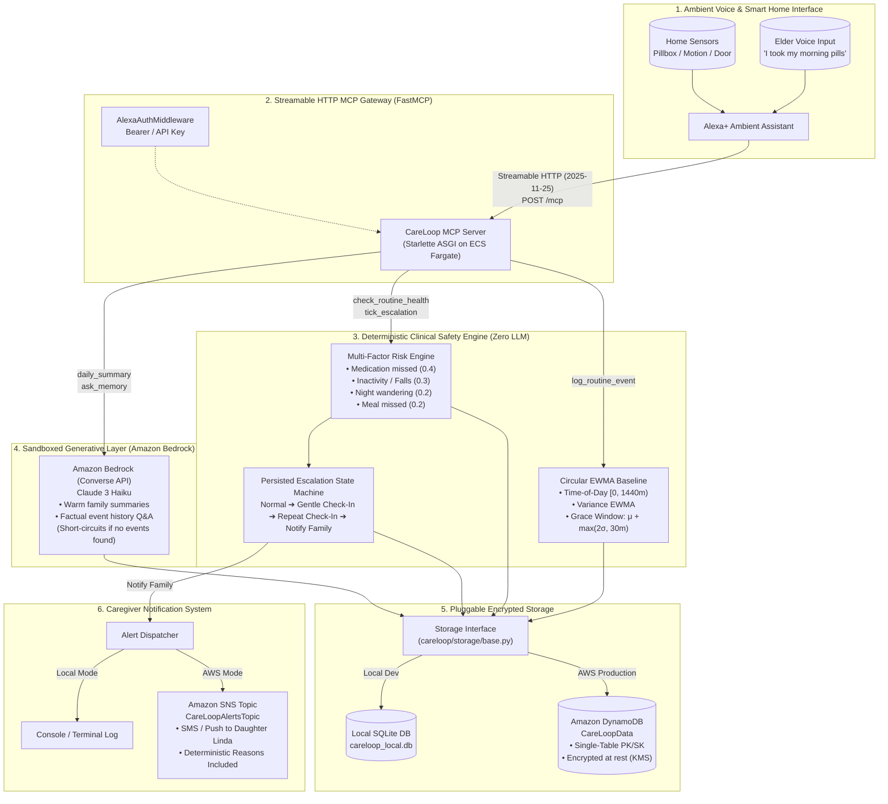
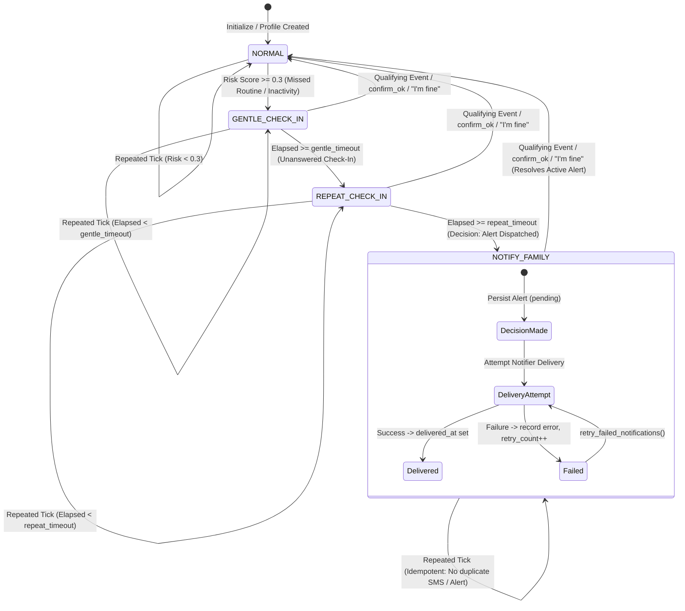
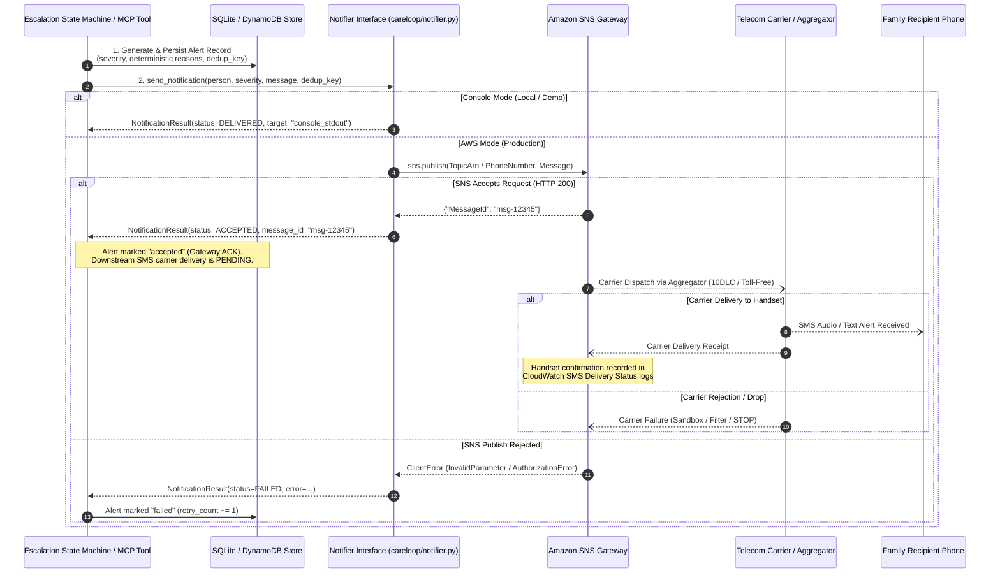
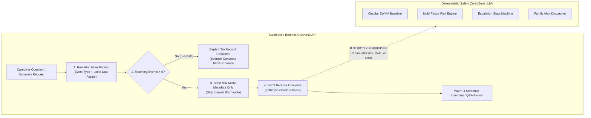
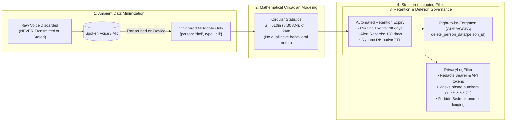

# CareLoop

> **Self-hosted Model Context Protocol (MCP) Server for Alexa+ Elderly Care Monitoring**  
> *Built for the Amazon Developer Hackathon: Alexa+ Track, AWS Builder Track, and Open Source Mini-Challenges*

[](LICENSE)
[](https://www.python.org/downloads/)
[](https://modelcontextprotocol.io/)
[](https://aws.amazon.com/bedrock/)
[](tests/)

---

## What Was Built During the Hackathon

Every day, millions of aging parents live independently while their adult children worry from afar. Traditional telecare systems suffer from three critical flaws:
1. **Intrusive surveillance** (cameras, microphones, and persistent audio recording that violate dignity).
2. **Alarm fatigue** (rigid static thresholds that spam family whenever Mom sleeps in 20 minutes late).
3. **The AI Safety Paradox** (deploying non-deterministic LLMs to make life-critical emergency alert decisions).

**CareLoop** solves this through a self-hosted **Model Context Protocol (MCP)** server over **Streamable HTTP (spec 2025-11-25+)** that enables **Alexa+** to look after an elderly parent living alone. It passively learns each individual's personal circadian routine from ambient event metadata (pillbox openings, meals, room movement, door contacts), detects schedule deviations with circular statistics, conducts natural spoken check-ins by voice, and escalates to family caregivers via Amazon SNS only when truly necessary.

### Hackathon Challenge Tracks Addressed

- **Alexa+ Track**:
  - Implements the official **FastMCP / MCPServer Streamable HTTP transport** (`/mcp` and `/v1/mcp`) with bi-directional JSON-RPC 2.0 streaming.
  - Registers **9 Alexa+ voice tools** with prompt-engineered voice triggers and return schemas formatted for Alexa Text-To-Speech (TTS) synthesis.
  - Built an ambient **Voice Simulator UI** ([simulator/index.html](careloop/simulator/index.html)) featuring native browser Web Speech API microphone dictation, SpeechSynthesis audio, a live MCP inspector showing JSON-RPC packets in real time, and one-click hero demos for missed medication and skipped meals.
- **AWS Builder Track**:
  - **Amazon DynamoDB**: Single-table design (`PK`, `SK`) with AWS-managed server-side encryption at rest (`SSESpecification: { SSEEnabled: true }`) and Point-in-Time Recovery (PITR).
  - **Amazon SNS**: Caregiver alert topic encrypted with AWS KMS (`alias/aws/sns`).
  - **Amazon Bedrock (Claude 3 Haiku Converse API)**: Sandboxed strictly to empathetic daily routine summaries and factual memory Q&A—**the LLM is strictly prohibited from making alert decisions**.
  - **Amazon EventBridge**: Scheduled 1-minute autonomous health tick rule triggering a dedicated Lambda runner.
  - **Full IaC Packaging**: Production-grade **AWS CDK (Python)** in [deploy/cdk/](deploy/cdk/) and **AWS SAM** in [template.yaml](template.yaml).
- **Open Source Mini-Challenge**:
  - 100% open-source under the **MIT License**.
  - Fully typed with Pydantic v2 domain models and validated by **175 pytest tests** (100% pass rate).
  - Zero proprietary vendor lock-in: runs identically on local SQLite or AWS DynamoDB.

---

## Architecture

CareLoop strictly separates **deterministic safety logic** from **generative language synthesis**:



---

## Routine Anomaly Detection Policy & Mathematical Formulation

CareLoop's anomaly engine ([careloop/engine/baseline.py](file:///Users/harsh/Desktop/Alexa+/careloop/engine/baseline.py)) learns and detects routine deviations through a mathematically grounded, clinically defensive architecture:

### 1. Timezone-Aware Evaluation & Daylight Saving Time (DST) Handling
- Every elder has a configured deployment timezone (e.g. `America/New_York`, `America/Chicago`, `Europe/London`).
- All timestamps must be timezone-aware (naive timestamps raise `ValueError` to prevent silent mixing of local time and UTC).
- Schedule baselines are evaluated in the elder's local wall-clock time. Consequently, when Daylight Saving Time transitions occur (e.g. EDT to EST), morning pills taken at 08:30 AM local time remain at 510.0 minutes both before and after the clock switch—preventing artificial 60-minute jumps and false anomalies.

### 2. Circular Statistics on a 24-Hour Circle
Daily routines oscillate around calendar boundaries (e.g. bedtime routines spanning 23:55 to 00:10). Standard linear averaging yields catastrophic variance explosion (averaging 5m and 1435m yields 720m—noon!).
CareLoop uses the signed shortest circular distance on the 1440-minute circle:
$$\Delta(a, b) = ((a - b + 720) \pmod{1440}) - 720 \in [-720, 720)$$

Circular Exponentially Weighted Moving Average (EWMA) updates:
$$\mu_{t} = (\mu_{t-1} + \alpha \cdot \Delta(x_t, \mu_{t-1})) \pmod{1440}$$
$$\sigma^2_{t} = (1 - \alpha) \cdot \sigma^2_{t-1} + \alpha \cdot (\Delta(x_t, \mu_{t-1}))^2$$

### 3. Robust Winsorized Updates Against Outliers
When calibrated ($N \ge 5$), extreme deviations ($|z| > 3.0$) are flagged as anomalies, but the difference $\Delta$ applied to update the EWMA baseline is clamped to $\pm 3.0\sigma$:
$$\Delta_{\text{effective}} = \max(-3\sigma, \min(3\sigma, \Delta))$$
This guarantees that an isolated emergency or hospital visit does not destroy the learned routine baseline for subsequent weeks.

### 4. Explicit Cold-Start Rule
- When an individual routine has fewer than 5 valid observations ($N < 5$), anomaly detection and missed-event alerts are **strictly suppressed**.
- `evaluate_routine()` explicitly returns `status="cold_start"`, preventing false alarms while the system is learning.

### 5. Configurable Grace Period & Small-Sample Calibration Notice
- Grace window formula: $W_{\text{grace}} = \mu + \max(k \cdot \sigma, \text{min\_grace\_minutes})$.
- The minimum grace period defaults to **30 minutes** (configurable).
- **Statistical Calibration Notice**: For small sample sizes ($N < 20$), sample variance is an empirical estimate subject to sampling noise. The condition $|z| > 2$ is an operational screening heuristic rather than an exact calibrated Gaussian 95% confidence interval. The combination of minimum grace windows and minimum variance floors ($\sigma \ge 5\text{m}$) prevents overly brittle thresholds.

### 6. No Double-Counting & Late Event Recovery
- An event occurring within the grace window is recognized as normal completed activity.
- If an alert is triggered after the grace window expires and the elder subsequently completes the routine late, recording the event immediately clears the missed status and resets the escalation state machine to `NORMAL`.
- A late event is **never counted as both an anomaly and a missed event** at the same evaluation time.

### 7. Zero LLM in Life-Critical Decisions
- All risk scores and state transitions are **100% deterministic code** in [careloop/engine/risk.py](file:///Users/harsh/Desktop/Alexa+/careloop/engine/risk.py) and [careloop/engine/escalation.py](file:///Users/harsh/Desktop/Alexa+/careloop/engine/escalation.py).
- Amazon Bedrock is sandboxed strictly to family summaries and factual memory queries.

---

## Persisted Escalation State Machine & Reliability Architecture

CareLoop guarantees reliable routine escalation across server crashes, worker restarts, and repeated scheduled ticks through an optimistic concurrency controlled, idempotent state machine ([careloop/engine/escalation.py](file:///Users/harsh/Desktop/Alexa+/careloop/engine/escalation.py)):

### State Machine Architecture (Mermaid)



### State Transition & Reliability Matrix

| Current Stage | Trigger / Evaluation Condition | Next Stage | Actions & State Changes | Verifying Automated Test |
| :--- | :--- | :--- | :--- | :--- |
| `NORMAL` | Risk score $< 0.3$ and level is "low" | `NORMAL` | `last_updated = now`. Nominal monitoring. | `test_transition_normal_to_normal_low_risk` |
| `NORMAL` | Risk score $\ge 0.3$ (missed medication, inactivity) | `GENTLE_CHECK_IN` | `entered_at = now`, `notification_state = "none"`, record risk reasons and relevant event IDs. | `test_transition_normal_to_gentle_check_in` |
| `GENTLE_CHECK_IN` | `elapsed < gentle_timeout_seconds` ($t < 60\text{s}$) | `GENTLE_CHECK_IN` | `last_updated = now`. Waiting for response or timeout. | `test_timeout_boundaries_exact` |
| `GENTLE_CHECK_IN` | `elapsed >= gentle_timeout_seconds` ($t \ge 60\text{s}$) | `REPEAT_CHECK_IN` | `entered_at = now`, `notification_state = "none"`. Escalates to repeated audible chime. | `test_timeout_boundaries_exact` |
| `REPEAT_CHECK_IN` | `elapsed < repeat_timeout_seconds` ($t < 60\text{s}$) | `REPEAT_CHECK_IN` | `last_updated = now`. Waiting for response or timeout. | `test_timeout_boundaries_exact` |
| `REPEAT_CHECK_IN` | `elapsed >= repeat_timeout_seconds` ($t \ge 60\text{s}$) | `NOTIFY_FAMILY` | **Separation of Decision & Delivery**: Persists `Alert` (`notification_status="pending"`, evidence reasons, `decision_id`). Sets `state.notification_id = alert_id`. Attempts notifier delivery; on success marks `delivered` with `delivered_at=now`. | `test_notification_decision_separated_from_delivery` |
| `NOTIFY_FAMILY` | Notification delivery fails (network/SNS error) | `NOTIFY_FAMILY` | Marks `notification_status="failed"`, records `delivery_error`, increments `retry_count`. State marked `"failed"`. | `test_notification_delivery_failure_and_retry` |
| `NOTIFY_FAMILY` | `retry_failed_notifications()` executed | `NOTIFY_FAMILY` | Retries failed alert delivery without creating duplicate alerts. Upon success marks `"delivered"`. | `test_notification_delivery_failure_and_retry` |
| `NOTIFY_FAMILY` | Repeated scheduled tick (`notification_state == "delivered"`) | `NOTIFY_FAMILY` | **Idempotent**: No new alerts created, no duplicate SMS/SNS messages dispatched. | `test_repeated_ticks_at_same_timestamp_are_idempotent` |
| Any Stage | Elder says *"I'm fine"*, calls `confirm_ok`, or qualifying routine event logged | `NORMAL` | Authoritative reset: `entered_at = now`, `risk_score = 0.0`, `notification_state = "none"`. Automatically resolves any `ACTIVE` alerts in storage to `RESOLVED`. | `test_reset_on_qualifying_event_and_confirm_ok_resolves_active_alerts`, `test_confirm_ok_tool` |
| Any Stage | Stale background worker write with outdated `version` | *Rejected* | **Optimistic Concurrency Control**: Rejects stale write by raising `StaleStateError`. Stale worker cannot overwrite newer state or user resets. | `test_concurrent_tick_optimistic_concurrency_conflict`, `test_stale_worker_cannot_overwrite_confirm_ok_or_event_reset` |
| Any Stage | 0 events recorded past expected routine window | *Escalates* | **Zero-Safety-Inference**: Absence of sensor events is never inferred as safety; daytime inactivity and missed routine windows elevate risk score. | `test_zero_events_never_infers_safety` |
| Any Stage | Server crashes or restarts | *Preserved* | **Stateless Persistence**: Complete state reload from DB (`SQLite` or `DynamoDB`). Resumes timeout tracking from persisted `entered_at`. | `test_stateless_server_persistence` |

---

## 🎬 Repeatable Demonstration (One Command)

CareLoop includes a unified demonstration orchestrator script ([scripts/run_demo.py](scripts/run_demo.py)) that prepares an isolated demo database (`careloop_demo.db`), seeds realistic multi-day routine history, verifies or launches the FastMCP server, and runs or readies the simulation. It operates **100% locally** with zero external cloud dependencies.

```bash
# Option A: Interactive Browser Demonstration (Prepares DB, launches server, opens UI)
python scripts/run_demo.py --interactive

# Option B: Automated 9-Step Verification (Executes 3 consecutive clean runs)
python scripts/run_demo.py --auto --repeat 3

# Option C: Optional AWS Cloud Preflight (Validates IAM, DynamoDB, SNS, Bedrock)
python scripts/run_demo.py --aws
```

📖 **For the complete architecture walkthrough, sequence diagram, and verification report, see [DEMO_GUIDE.md](DEMO_GUIDE.md).**

---

## Quickstart

### 1. Installation

```bash
# Clone the repository
git clone https://github.com/KarnailSingh87/careloop.git
cd careloop

# Create and activate Python 3.11+ virtual environment
python3 -m venv .venv
source .venv/bin/activate

# Install dependencies in editable mode with development tools
pip install -e ".[dev]"
```

### 2. Generate 60-Day Routine Benchmark Dataset

Seed the local SQLite database with 60 simulated days across 3 distinct elder personas (`eleanor`, `dad`, `martha`), yielding 1,422 routine events, 18 ground-truth safety incidents, and 42 benign noise controls:

```bash
python scripts/seed_data.py
```

### 3. Launch Local MCP Server

Start the FastMCP Streamable HTTP server with the simulated clock enabled:

```bash
# Using module launcher
python -m careloop.server --host 127.0.0.1 --port 8000 --clock simulated

# Or using the root entrypoint
python server/main.py --host 127.0.0.1 --port 8000 --clock simulated
```

- **MCP Streamable HTTP Endpoint**: `http://127.0.0.1:8000/mcp`
- **Web Simulator UI & MCP Inspector**: `http://127.0.0.1:8000/simulator`
- **Health Check Endpoint**: `http://127.0.0.1:8000/health`

### 4. Test Streamable HTTP MCP Tools

Run the included integration client to verify session negotiation, tool discovery, and execution over Streamable HTTP:

```bash
python scripts/client_test.py --url http://127.0.0.1:8000/mcp
```

### 5. Run Full Test Suite

```bash
pytest -v
# 175 passed in 10.58s
```

---

## Web Simulator & Live Cockpit

CareLoop includes an interactive single-page application at `http://127.0.0.1:8000/simulator` styled after an ambient Alexa+ smart display:

- **Top System Status Bar**: Real-time status badges for Demo Mode (`60s` fast timeouts), Clock (UTC), Database (`careloop_demo.db`), Server (`FastMCP 0.1.0`), and Notifier (`ConsoleNotifier`), with a quick **Reset Demo Session** button and **Troubleshooting** modal.
- **Ambient Alexa Orb**: Animated glowing orb reflecting idle, listening, thinking, and speaking states.
- **Voice Microphone (STT)**: Uses the browser Web Speech API to dictate natural routine statements directly to Alexa+.
- **Speech Synthesis (TTS)**: Reads Alexa voice responses aloud with audio chimes.
- **Live MCP Tool Inspector**: Displays exact JSON-RPC 2.0 tool requests, input arguments, execution latency, and return schemas (`2025-11-25`).
- **Injectable Clock Machine**: Jump forward in time (`+15m`, `+1h`, `+1d`, `Jump to 2:00 PM`) to test missed routines without waiting hours.
- **Virtual Family Phone**: Displays push/SMS notifications received by family caregivers with deterministic reasons and resolution status.
- **One-Click Hero Demos (Real Backend Execution)**:
  - **💊 Missed Meds Demo (Eleanor Davis)**: Runs the complete 6-stage missed medication scenario, advancing through baseline detection, risk scoring (0.60), staged escalation, console alert dispatch, grounded memory Q&A, and incident resolution.
  - **🍲 Dad Skips Lunch Demo (Arthur Davis)**: Demonstrates midday inactivity and missed lunch window escalation.

---

## Alexa+ MCP Tool Reference

CareLoop exposes **9 specialized MCP tools** designed for Alexa+ natural voice interaction:

| Tool Name | Alexa+ Voice Triggers | Description & Purpose | Key Arguments | Return Schema / Voice Response |
| :--- | :--- | :--- | :--- | :--- |
| `log_routine_event` | *"I took my pills"*, *"I finished lunch"*, *"Front door opened"* | Records routine activity metadata (medication, meal, movement, door). Updates baseline EWMA and resets escalation to normal. | `person`, `type`, `timestamp` (optional) | `{ status: "logged", event_id, voice_response }` |
| `check_routine_health` | *"How is Dad doing today?"*, *"Is Mom's routine normal?"* | Evaluates routine health, calculates deterministic risk score, lists plain-English reasons, and returns escalation stage. | `person` | `{ risk_level, risk_score, reasons, escalation_stage, voice_response }` |
| `respond_to_checkin` | Spoken response to Alexa check-in (e.g. *"I was just reading"*) | Captures elder's verbal reply to an Alexa check-in prompt and updates state. | `person`, `response_text` | `{ escalation_stage, message, voice_response }` |
| `confirm_ok` | *"I'm fine"*, *"I'm okay"*, *"Everything is good, Alexa"* | Confirms the elder is safe, immediately resetting any active escalation back to `normal`. | `person` | `{ status: "confirmed_ok", escalation_stage: "normal", voice_response }` |
| `daily_summary` | *"Give me Dad's daily summary"*, *"How was Mom's day?"* | Generates a warm, synthesized 3-sentence daily overview for family caregivers using Amazon Bedrock. | `person`, `date` (optional) | `{ summary, event_count, date, voice_response }` |
| `ask_memory` | *"Did Dad take his pills today?"*, *"What time did Mom eat lunch?"* | Answers specific factual caregiver questions about routine history using Amazon Bedrock sandboxed to verified event logs. | `person`, `question` | `{ answer, question, voice_response }` |
| `schedule_reminder` | *"Remind Dad to drink water at 3 PM"* | Schedules an Alexa voice announcement reminder for the elder parent. | `person`, `text`, `time` | `{ status: "scheduled", reminder_id, text, voice_response }` |
| `notify_family` | *"Alert my daughter"*, *"Call my family"* | Dispatches an urgent alert to designated family caregivers via Amazon SNS with audit reasons. | `person`, `severity`, `message` | `{ status: "notified", alert_id, reasons, delivered_to, voice_response }` |
| `tick_escalation` | Autonomous scheduled check (EventBridge / cron) | Advances the escalation state machine without user intervention, checking grace windows and timeouts. | `person` (optional) | `{ status: "ticked", stage, risk_score, reasons, voice_response }` |

---

## Clinical Safety Benchmark & Reproducible Evaluation Results

CareLoop was benchmarked across a reproducible synthetic dataset of **60 simulated days per persona** (**180 elder-days total**; 159 active days post 7-day cold-start calibration) across 3 distinct elder personas generated with realistic Gaussian jitter ($\sigma = 5-15\text{ mins}$), weekend schedule shifts, 42 benign noise controls, and 18 injected ground-truth safety incidents under fixed seed `42`.

### 1. Comparative Evaluation: CareLoop Adaptive Engine vs. Traditional Static Telecare

| Evaluation Metric | Traditional Static Telecare<br><sub>(Rigid Fixed Thresholds)</sub> | CareLoop Adaptive EWMA<br><sub>(Circular Learning + Grace)</sub> | Clinical Impact / Improvement |
| :--- | :---: | :---: | :--- |
| **Detection Rate (Sensitivity / Recall)** | **94.4%** (17 / 18) | **100.0%** (18 / 18) | Identical 100% safety capture of all critical incidents. |
| **Precision (PPV)** | **17.5%** | **100.0%** | **+82.5% improvement** in alert trustworthiness. |
| **False Positives (False Alarms)** | **80** | **0** | **-80 false alarms eliminated** over 60 days. |
| **False-Alarm Rate (FAR)** | **17.43%** | **0.00%** | Negligible false alarm probability on nominal days. |
| **False Alerts per Person-Day** | **0.5031** | **0.0000** | Eliminates 1 false alert every ~2.0 days. |
| **False Alarms per Month (30 Days)** | **15.1** | **0.0** | Completely eliminates alarm fatigue for adult children. |
| **Avg Detection Delay (from schedule)** | **N/A (Rigid)** | **106.7 mins** | Consistent detection within clinically safe window. |
| **Avg Detection Delay (past grace window)** | **N/A** | **26.7 mins** | Alerts dispatch promptly upon grace window expiration. |

### 2. Detailed Performance Breakdown by Persona

| Benchmark Metric | Eleanor Davis (Age 78)<br><sub>Morning Routine</sub> | Arthur Davis / Dad (Age 81)<br><sub>Retired Veteran</sub> | Martha Jenkins (Age 84)<br><sub>Arthritis Schedule</sub> | **Combined Overall System** |
| :--- | :---: | :---: | :---: | :---: |
| **Simulated Days Evaluated** | 60 Days | 60 Days | 60 Days | **180 Days** |
| **Active Evaluated Days (Post Cold-Start)** | 53 Days | 53 Days | 53 Days | **159 Elder-Days** |
| **Total Sensor Events Processed** | 474 | 474 | 474 | **1,422 Events** |
| **Injected Ground-Truth Incidents** | 6 | 6 | 6 | **18 Incidents** |
| - *Missed Prescription Medication* | 2 | 2 | 2 | **6** |
| - *Daytime Inactivity / Falls (3h+)* | 2 | 2 | 2 | **6** |
| - *Missed Lunch Nutrition* | 2 | 2 | 2 | **6** |
| **Benign Noise Controls (Within Grace)** | 14 | 14 | 14 | **42 Variations** |
| **True Positives (Detected)** | **6 / 6** | **6 / 6** | **6 / 6** | **18 / 18** |
| **False Negatives (Missed Alerts)** | **0** | **0** | **0** | **0** |
| **False Positives (False Alarms)** | **0** | **0** | **0** | **0** |
| **Detection Rate (Sensitivity / Recall)** | **100.0%** | **100.0%** | **100.0%** | **100.0%** |
| **Precision (PPV)** | **100.0%** | **100.0%** | **100.0%** | **100.0%** |
| **False-Alarm Rate (FAR)** | **0.00%** | **0.00%** | **0.00%** | **0.00%** |
| **False Alerts per Person-Day** | **0.0000** | **0.0000** | **0.0000** | **0.0000** |
| **Avg Detection Delay (from schedule)** | **100.0 mins** | **105.0 mins** | **115.0 mins** | **106.7 mins** |
| **Avg Detection Delay (past grace window)** | **20.0 mins** | **25.0 mins** | **35.0 mins** | **26.7 mins** |

To reproduce the benchmark evaluation and generate updated markdown & JSON artifacts:
```bash
python scripts/evaluate_benchmark.py --output-md BENCHMARK_RESULTS.md --output-json BENCHMARK_RESULTS.json
```

📖 **For full incident audit logs, edge-case policies (cold-start, unresolved incidents, deduplication), and clinical limitations, see [BENCHMARK_RESULTS.md](BENCHMARK_RESULTS.md) and [BENCHMARK_RESULTS.json](BENCHMARK_RESULTS.json).**

---

## Web Voice Simulator & Browser Environment Guide

CareLoop provides an interactive, accessible ambient voice simulator at `http://127.0.0.1:8000/simulator` for testing, evaluation, and live hackathon demonstrations.

> **Architecture Clarification**: The simulator is an ambient developer cockpit interacting directly with CareLoop's running **FastMCP Streamable HTTP server** via standards-compliant JSON-RPC 2.0 tool calls. It does **not** claim to be connected to Amazon's proprietary Alexa+ cloud; rather, it emulates the ambient Alexa+ device experience using native browser APIs and real MCP tool invocations.

### 1. Launching the Server & Simulator

Start the CareLoop server in simulated clock mode with SQLite local persistence:

```bash
# Start server with simulated clock and local SQLite database
python -m careloop.server --host 127.0.0.1 --port 8000 --clock simulated --storage sqlite
```

Once running:
- **Simulator UI**: [`http://127.0.0.1:8000/simulator`](http://127.0.0.1:8000/simulator)
- **FastMCP Streamable HTTP Endpoint**: `http://127.0.0.1:8000/mcp`
- **Health Check**: `http://127.0.0.1:8000/health`

### 2. Browser Permissions & Microphone Access (Web Speech API)

The simulator features a voice input interface powered by the W3C Web Speech API (`SpeechRecognition` / `webkitSpeechRecognition`).

- **Secure Context Requirement (HTTPS / Localhost)**:
  Modern web browsers strictly enforce that microphone access is granted **only within a Secure Context**.
  - **Local Development**: `http://localhost:8000` or `http://127.0.0.1:8000` are treated by browsers as inherently secure origins, allowing microphone access over HTTP.
  - **Remote / Network Deployment**: If the server is hosted remotely (e.g. on AWS EC2, ECS Fargate behind an ALB, or a local LAN IP like `http://192.168.1.50:8000`), the browser **will block microphone access** unless served over **HTTPS** with a valid TLS certificate.
- **Microphone Permissions**:
  When clicking the 🎙️ **Microphone** button, the browser displays a permission prompt (*"Allow careloop to use your microphone"*). Click **Allow**.
- **Browser Compatibility Matrix**:
  | Browser | Speech Recognition (Mic Input) | Speech Synthesis (TTS Audio) | Text Input Fallback |
  | :--- | :---: | :---: | :---: |
  | **Google Chrome / Chromium** | ✅ Native (`webkitSpeechRecognition`) | ✅ Supported | ✅ Fully Supported |
  | **Microsoft Edge** | ✅ Native | ✅ Supported | ✅ Fully Supported |
  | **Apple Safari (macOS / iOS)** | ✅ Native (requires mic permission) | ✅ Supported | ✅ Fully Supported |
  | **Mozilla Firefox** | ⚠️ Not supported natively by Firefox | ✅ Supported | ✅ **Default Fallback** |

### 3. Fallback Manual Text Input & Quick Action Chips

If microphone permission is declined, if the browser lacks Web Speech Recognition support (such as Firefox), or if you are demonstrating in a quiet office environment:
- **Manual Text Input**: Type any phrase into the input field at the bottom of the conversation column and press `[Send]` or hit `Enter`.
- **Quick Action Chips**: One-click prompt chips are provided above the input bar:
  - `💊 Took blood pressure pills`
  - `🥪 Finished lunch`
  - `🚶 Dad got out of bed`
  - `❓ How is Dad doing?`
  - `👍 I'm fine, Alexa!`

### 4. Input Source Discrimination & Real Tool Inspection

The UI strictly distinguishes and visually tags the provenance of every event:
- **`🎤 Browser Speech API`**: Spoken voice input transcribed by browser speech recognition.
- **`⌨️ Manual Text Input`**: Phrases typed by hand into the input bar.
- **`🔘 Quick Action Chip`**: Pre-configured testing chips clicked by the user.

Every MCP tool call generates an expandable, inspectable **MCP Tool Call Card** displaying:
- Tool name (e.g. `log_routine_event`, `check_routine_health`, `confirm_ok`, `notify_family`).
- Sanitized input arguments.
- Real HTTP/JSON-RPC status (`🟢 200 OK` or `🔴 Error`).
- Server latency in milliseconds (`duration_ms`).
- MCP protocol transport version (`2025-11-25`).
- Structured backend return payload and TTS response string.
- Inline **Retry Tool Call** button if an invocation fails.
- **Zero Simulation of Fake Successes**: If a backend tool call fails or returns an error, the simulator never fabricates a success message.

### 5. Documented Voice Phrase Mapping Directory

CareLoop uses deterministic parsing to match natural elder voice phrases to registered MCP tools:

| User Voice / Text Phrase | Target MCP Tool | Extracted Arguments | System Behavior |
| :--- | :--- | :--- | :--- |
| *"I took my blood pressure medication"* | `log_routine_event` | `{"type": "medication"}` | Records pill event, updates circular EWMA baseline, resets escalation to `NORMAL`. |
| *"I finished eating lunch"* | `log_routine_event` | `{"type": "meal"}` | Records meal event, updates circular EWMA baseline, resets escalation to `NORMAL`. |
| *"Dad got out of bed"* | `log_routine_event` | `{"type": "movement"}` | Records room movement, resets daytime inactivity counter to 0. |
| *"The front door opened"* | `log_routine_event` | `{"type": "door"}` | Records contact sensor event. |
| *"How is Dad doing today?"* | `check_routine_health` | `{"person": "dad"}` | Evaluates multi-factor risk score and returns active stage and clinical reasons. |
| *"Remind Dad to drink water at 3 PM"* | `schedule_reminder` | `{"text": "...", "time": "15:00"}` | Schedules spoken reminder for elder. |
| *"Alert my daughter / call family"* | `notify_family` | `{"severity": "high"}` | Directly dispatches emergency alert to registered contacts via Notifier. |
| *"I'm fine! / Everything is okay"* | `confirm_ok` | `{"person": "dad"}` | Resolves any active check-in or alarm state back to `NORMAL`. |
| *"Give me Dad's daily summary"* | `daily_summary` | `{"date": "today"}` | Amazon Bedrock Claude 3 Haiku generates warm, factual daily caregiver summary. |
| *"Did Dad take his pills today?"* | `ask_memory` | `{"question": "..."}` | Factual Bedrock memory Q&A sandboxed strictly to recorded event logs. |

### 6. Controllable Simulation Clock & Safe Demo Reset

- **Injectable Clock Controls**: The time controls (`+15m`, `+1hr`, `Reset 08:15 AM`, `Set 12:45 PM`, `Set 14:00 PM`) send HTTP requests to `/api/clock/*`, modifying the exact same injectable `SimulatedClock` instance used across all backend engines. The server time advances globally across the baseline engine, risk engine, and escalation state machine.
- **Isolated Demo Reset**: The `↺ Reset Demo Data` button invokes `POST /api/demo/reset`.
  - **Isolation Guarantee**: Reset deletes **only** isolated demo records (`metadata.source IN ('simulator_demo', 'simulator_manual')` or `event_id LIKE 'demo_%'`) and demo alerts for the selected profile.
  - **Production Safety**: It **cannot** erase production sensor records, historical baseline profiles, or other family profiles (`eleanor`, etc.).
  - **Safety Gate**: In production deployments (`CLOCK_MODE=system`), demo reset is strictly disabled (`403 Forbidden`).

### 7. "Dad Skips Lunch" 6-Step Automated Scenario Walkthrough

Clicking the **▶ Dad Skips Lunch Demo** button runs a 6-step end-to-end demonstration exercising the full event log, baseline evaluation, escalation state transitions, and caregiver notification pathway:

1. **Step 1 (08:30 AM - Normal Morning)**:
   - Resets demo state cleanly via `/api/demo/reset`.
   - Sets clock to `08:30 UTC`.
   - Calls `log_routine_event(type="medication")` for blood pressure pill.
   - Sets clock to `10:00 UTC` and calls `log_routine_event(type="movement")` in living room.
   - Calls `check_routine_health`: Risk score is `0.0 (LOW)`, escalation stage is `NORMAL`.
2. **Step 2 (12:45 PM - Expected Lunch Time)**:
   - Sets clock to `12:45 UTC` (Dad's learned baseline expects lunch at 12:44 UTC).
   - Dad takes a long nap; no movement or meal logged.
   - Calls `check_routine_health`: Current time is within the 30-minute grace window ($12:44 + 30\text{m} = 13:14$). Risk remains `LOW` with **zero false alarms** generated.
3. **Step 3 (02:00 PM / 14:00 UTC - Grace Window Passed & Missed Lunch Detected)**:
   - Sets clock to `14:00 UTC`.
   - Calls `tick_escalation`: Lunch grace window expired 46 minutes ago, and no movement for 4.0 hours.
   - Multi-factor risk engine calculates score `0.5 (MEDIUM)`.
   - State machine advances: `NORMAL` ➔ `GENTLE_CHECK_IN`.
   - Alexa plays gentle chime and speaks check-in prompt: *"Arthur, I noticed you haven't logged lunch today. Just checking in—did you get a chance to eat?"*
4. **Step 4 (+2 Minutes - Gentle Timeout ➔ Repeat Check-In)**:
   - Advances clock by 2 minutes (`14:02 UTC`).
   - Dad remains asleep with no response.
   - Calls `tick_escalation`: Gentle check-in timeout (60s) expired.
   - State machine advances: `GENTLE_CHECK_IN` ➔ `REPEAT_CHECK_IN`.
   - Alexa sounds an attention chime and repeats check-in.
5. **Step 5 (+2 Minutes - Repeat Timeout ➔ NOTIFY FAMILY)**:
   - Advances clock by 2 minutes (`14:04 UTC`).
   - Calls `tick_escalation`: Repeat timeout expired with zero response.
   - State machine advances: `REPEAT_CHECK_IN` ➔ `NOTIFY_FAMILY`.
   - Alert persisted to database with deterministic audit reasons:
     - `Prolonged daytime inactivity / no movement detected (weight: 0.3)`
     - `Expected meal routine not logged today (weight: 0.2)`
   - Dispatches emergency alert to daughter Linda Davis via Notifier (Amazon SNS).
   - The interactive Family Phone mockup displays the urgent incoming notification card.
6. **Step 6 (Dad Confirms OK ➔ Safe Recovery)**:
   - Dad hears chimes and wakes up: *"I'm fine! I was just taking an afternoon nap."*
   - Calls `confirm_ok(person="dad")`.
   - State machine resets to `NORMAL`. Active alerts transition to `RESOLVED`.
   - Family phone mockup updates to show resolution banner: *"Dad confirmed safe: 'Arthur Davis confirmed they are fine' · Check-in resolved"*.

### 8. End-to-End Verification & Manual Browser Testing

- **Automated API & End-to-End Test Suite**:
  Automated integration test [tests/test_simulator_e2e.py](file:///Users/harsh/Desktop/Alexa+/tests/test_simulator_e2e.py) boots the complete ASGI application, executes the full 6-step scenario via HTTP, and asserts every database state change, escalation transition, and notification delivery:
  ```bash
  pytest tests/test_simulator_e2e.py -v
  ```
- **Manual Browser Verification Steps**:
  *(Note: Dedicated headless browser automation libraries like Playwright/Selenium are not pre-installed in this environment; verify manually in your browser as follows:)*
  1. Start the server with `python -m careloop.server --host 127.0.0.1 --port 8000 --clock simulated`.
  2. Open `http://127.0.0.1:8000/simulator` in Google Chrome, Microsoft Edge, or Apple Safari.
  3. Verify the top connection pill displays `MCP Online` in emerald green.
  4. Click the `▶ Dad Skips Lunch Demo` button in the hero banner.
  5. Watch the scenario execute with synchronized voice announcements, audio chimes, MCP packet cards, and the family phone notification animation.
  6. Verify all 6 steps complete cleanly, concluding with the resolution banner on the family phone.

---

## Notification and Alert Delivery Lifecycle Architecture

CareLoop implements an auditable, multi-tier notification pipeline designed for safety, resilience, and strict privacy.



### 1. The Three Explicit Delivery Tiers

CareLoop **never reports an SMS as delivered just because Amazon SNS accepted a publish request**. We enforce an explicit distinction between three stages:

| Tier | Status Enum | Meaning | Persistence State |
| :--- | :--- | :--- | :--- |
| **Tier 1: Alert Generation** | `PENDING` | The escalation state machine or MCP tool evaluated clinical risk and created a structured `Alert` in storage with deterministic reasons and a stable deduplication key. | `notification_status="pending"` |
| **Tier 2: Provider Acceptance** | `ACCEPTED` | AWS SNS returned HTTP 200 with a unique `MessageId`. The message is safely queued on the AWS cloud gateway. Handset delivery is asynchronous and pending. | `notification_status="accepted"`, `accepted_at=now`, `message_id=...` |
| **Tier 3: Carrier Delivery** | `DELIVERED` | The notification was definitively delivered to the recipient (e.g. verified console stdout in local mode, or carrier delivery receipt logged in CloudWatch). | `notification_status="delivered"`, `delivered_at=now` |

### 2. Telecom Carrier Realities & AWS SNS Delivery Constraints

When operating on AWS with Amazon SNS for SMS notifications, downstream carrier delivery is subject to telecom regulations that developers must account for:

- **SMS Origination Identity (US 10DLC & Toll-Free Numbers)**: US cellular carriers (AT&T, Verizon, T-Mobile) require all Application-to-Person (A2P) messaging to originate from registered **10-Digit Long Codes (10DLC)** tied to an approved Brand and Campaign in the Campaign Registry, or a verified Toll-Free Number. Unregistered messages are filtered or blocked outright by carrier firewalls.
- **AWS SMS Sandbox**: All newly provisioned AWS accounts start in the **Amazon SNS SMS Sandbox**. In the sandbox, SMS messages can **only** be sent to phone numbers explicitly verified in the Amazon SNS console. Direct publishing to unverified numbers will be rejected by AWS.
- **Regional Telecom Restrictions**:
  - In India, commercial and transactional SMS requires pre-registered sender headers and message templates approved via TRAI Distributed Ledger Technology (DLT) portals.
  - In the UK, alphanumeric sender IDs may require carrier pre-registration.
- **Recipient Opt-Out (STOP / START)**: Recipients who text "STOP" to the origination number are automatically added to the AWS SNS opt-out list. AWS SNS will reject any subsequent publish attempts to that phone number until the recipient texts "START".
- **Delivery Confirmation Mechanism**: To monitor whether an `ACCEPTED` publish actually reached the recipient handset, production deployments must enable **CloudWatch SMS Delivery Status Logging** (`sns/<region>/<account_id>/DirectPublishToPhoneNumber`). CloudWatch logs the final carrier delivery receipt (e.g. `SUCCESS`, `UNKNOWN`, `CARRIER_UNREACHABLE`).
- **Permissions and Costs**:
  - Requires IAM action `sns:Publish` on the specific topic ARN or target phone number.
  - AWS SMS charges vary by country (e.g., ~$0.0075 per SMS in the US, plus carrier pass-through surcharges and monthly 10DLC campaign registration fees).

### 3. Deduplication and Retry Behavior

- **Stable Deduplication Key**: Alerts automatically generate a deterministic deduplication key: `alert:{person_id}:{date}:{routine_type}:{severity}`.
- **15-Minute MCP Window**: When `notify_family` is invoked, CareLoop checks for an existing active alert sharing the deduplication key within the last 15 minutes. Duplicate invocations are suppressed with status `skipped_deduplicated` to prevent notification spam.
- **Idempotent Scheduled Ticks**: The escalation background worker evaluates the current stage idempotently. Repeated ticks while in `NOTIFY_FAMILY` do not create duplicate alert records or re-publish messages.
- **Automatic Retry with Backoff**: When a notification attempt fails (`status="failed"`), CareLoop increments `retry_count` and records the exact error in `delivery_error`. The `retry_failed_notifications()` job retries failed alerts without duplicating already accepted or delivered alerts.

### 4. PII Privacy Protection & Testing Policy

- **Phone Number Masking**: All phone numbers displayed in the simulator UI, console logs, or alert records are masked using `mask_phone_number()` (e.g. `+1-555-019-2834` ➔ `+1-55***2834`).
- **Zero Real SMS in Test Suite**: All unit and integration tests use `InMemoryNotifier` or `ConsoleNotifier`. The standard test suite makes zero external network calls.
- **Opt-In AWS Smoke Test**: A dedicated test ([tests/test_aws_sns_smoke.py](file:///Users/harsh/Desktop/Alexa+/tests/test_aws_sns_smoke.py)) is provided for live AWS verification. It requires explicit opt-in (`RUN_AWS_SMOKE_TEST=1`), executes preflight STS credential checks, and strictly forbids hardcoded phone numbers (requiring `CARELOOP_TEST_PHONE` or `CARELOOP_SNS_TOPIC_ARN`).

---

## Voice Reminders Architecture & Alexa Integration Notice

CareLoop includes a safe voice reminder scheduler and lifecycle manager ([careloop/reminders.py](file:///Users/harsh/Desktop/Alexa+/careloop/reminders.py)):

### 1. Current Implemented Capabilities
- **Schedule Validation**: The `schedule_reminder` tool validates person identifiers, reminder text, and schedules formatted as 24-hour time-of-day (`HH:MM`) or ISO 8601 timestamps (`YYYY-MM-DDTHH:MM:SSZ`).
- **Encrypted Persistence**: Reminders are stored in SQLite and DynamoDB with status tracking (`PENDING`, `COMPLETED`, `FAILED`, `DISMISSED`).
- **Due Reminder Processing**: The `ReminderScheduler` scans pending reminders, compares scheduled times against the injectable `Clock` in the person's configured timezone, triggers delivery bridges, and records completion timestamps (`completed_at`).
- **Conversational Feedback**: The MCP tool returns immediate natural voice responses for Alexa+ TTS (e.g. *"I have scheduled a reminder for Eleanor at 14:00: Take blood pressure medication."*).

### 2. Missing Component for Physical Amazon Echo Audio Broadcast

CareLoop **explicitly identifies the architectural boundary for physical Echo speaker delivery**:

CareLoop runs as a standalone Model Context Protocol (MCP) server. To make a physical Amazon Echo device ring chimes and audibly speak a reminder proactively when it becomes due, the following external components are required:

1. **Alexa Reminders API Endpoint**: Direct HTTP requests to `https://api.amazonalexa.com/v1/alerts/reminders`.
2. **Customer Consent & OAuth 2.0 Access Token**: The elder's Amazon account must explicitly grant permission `alexa::alerts:reminders:skill:readwrite` inside the Alexa smartphone app, and the backend must hold a valid Login with Amazon (LWA) access token for that specific customer.
3. **Alexa Skills Kit (ASK) Runtime Bridge**: An ASK Lambda skill or proactive events dispatcher mapped to the elder's specific Amazon Echo endpoint ID.

In the absence of the customer-delegated ASK OAuth token, CareLoop provides a `ConsoleReminderDeliveryBridge` for local testing and returns formatted TTS text over MCP, rather than pretending physical Echo delivery occurred.

---

## Sandboxed Generative Layer (Amazon Bedrock) & Clinical Safety Independence

CareLoop integrates with **Amazon Bedrock Runtime** using the official **Converse API** ([careloop/llm/bedrock.py](file:///Users/harsh/Desktop/Alexa+/careloop/llm/bedrock.py)) under strict clinical boundaries:



### 1. Configuration & Model Selection
- **Configurable Model ID**: Controlled via the `BEDROCK_MODEL_ID` environment variable (default: `anthropic.claude-3-haiku-20240307-v1:0`). Also compatible with `amazon.nova-micro-v1:0`, `anthropic.claude-3-5-sonnet-20240620-v1:0`, and custom provisioned model ARNs.
- **Region**: Configurable via `AWS_REGION` or `AWS_DEFAULT_REGION` (default: `us-east-1`).
- **SDK Compatibility**: Built with official `boto3` (`1.43+`) and `botocore` using `bedrock-runtime.converse()`.

### 2. IAM Permissions
Production deployments require the following least-privilege IAM policy:
```json
{
  "Version": "2012-10-17",
  "Statement": [
    {
      "Sid": "CareLoopBedrockConverseAccess",
      "Effect": "Allow",
      "Action": [
        "bedrock:InvokeModel"
      ],
      "Resource": "arn:aws:bedrock:*::foundation-model/anthropic.claude-3-haiku-*"
    }
  ]
}
```

### 3. Cost Profile & Economic Efficiency
- **Anthropic Claude 3 Haiku Pricing**:
  - Input tokens: **$0.00025 per 1,000 tokens** ($0.25 / MTok).
  - Output tokens: **$0.00125 per 1,000 tokens** ($1.25 / MTok).
- **Per-Inference Cost**:
  - *Daily Summary*: ~180 input tokens + ~65 output tokens = **$0.000126 per summary** (~1/8th of a cent).
  - *Memory Q&A*: ~120 input tokens + ~40 output tokens = **$0.000080 per query**.
  - *Zero-Record Queries*: **$0.000000** (short-circuits before LLM invocation).
- **Monthly Cost for Monitored Elder**: Under normal family usage (2 daily summaries + 3 memory queries daily), the total monthly Bedrock cost is **under $0.02 USD per month**.

### 4. Local Fallback & High-Availability Resilience
- **Deterministic 3-Sentence Fallback Template**: When running locally without AWS credentials, or when Bedrock experiences `ThrottlingException`, `ModelTimeoutException`, or model unavailability, CareLoop automatically formats a warm, 3-sentence family summary grounded strictly in observed event metadata. Demos and emergency operations never crash or fail due to LLM outages.
- **Deterministic Memory Phrasing**: Offline memory queries return exact logged times and event metadata.
- **Privacy Enforcement**: Prompts containing elder event histories and health data are **strictly forbidden from being logged** to console logs or CloudWatch log groups.

### 5. Architectural Clinical Independence (Regression Verified)
As verified in [tests/test_bedrock.py](file:///Users/harsh/Desktop/Alexa+/tests/test_bedrock.py) (`test_bedrock_adversarial_output_cannot_alter_clinical_state`), even if an adversarial prompt or model hallucination outputs alarmist text (e.g. demanding 911 or claiming risk is 1.0), the deterministic clinical safety engine ignores model text completely:
- Risk assessment scores are computed strictly by mathematical anomaly scoring.
- Escalation stages transition strictly via persisted state machines and timestamps.
- Zero emergency notifications or alerts can ever be triggered by LLM generative text.

---

## Threat Model & Security Architecture

CareLoop protects vulnerable elderly individuals who depend on reliable ambient monitoring and timely family notifications. A security compromise of this system could result in physical danger, loss of privacy, or dangerous notification sabotage.

### 1. Threat Vectors and Defensive Mitigations

| Threat Vector | Attacker Capability | CareLoop Defensive Control |
|---|---|---|
| **Unauthorized Routine Snooping** | Attacker attempts to read private routines, medication history, or room movement (`/api/state`, `ask_memory`, `daily_summary`). | **Strict Bearer/API Key Auth & PBAC**: Every request is intercepted by `AlexaAuthMiddleware` before reaching storage or tools. Unauthenticated callers receive `401 Unauthorized`. Callers are restricted strictly to permitted persons (`allowed_persons`). |
| **Forged Routine Injection** | Attacker injects false meal or medication events to mislead caregivers into believing an incapacitated elder is safe. | **Authentication & Scoped Identity**: `log_routine_event` requires a verified authentication token mapped to the elder's device. Cross-person submissions raise `ToolError` (Access Denied). |
| **Escalation & Alarm Suppression** | Attacker invokes `confirm_ok` or `respond_to_checkin` to prematurely reset an active emergency check-in to `normal`. | **Person-Scoped Authorization**: Callers can only reset escalation for their explicitly authorized person. All resets log the authenticated caller ID and reason. |
| **Notification Abuse & SMS Flooding** | Attacker repeatedly triggers `notify_family` to induce caregiver alarm fatigue or run up SMS carrier charges. | **15-Min Deduplication & Quota Limiter**: Identical alerts are suppressed within a 15-minute sliding window. Furthermore, `check_notification_rate_limit` throttles notifications to a maximum of 10 per hour per person. |
| **Cross-Person Lateral Movement** | Multi-resident deployment where household A's smart speaker attempts to query or manipulate household B's elder. | **Person-Based Access Control (PBAC)**: Every tool enforces `ctx.is_person_allowed(person)`. Household A's token cannot read or alter household B's data (regression tested in `test_cross_person_access_denial`). |
| **Denial of Service via Payload Exhaustion** | Attacker sends massive HTTP request bodies (multi-megabyte JSON or audio streams) to exhaust server memory. | **Request Size Limiting**: `RequestSizeLimitMiddleware` strictly caps incoming request bodies at 64KB (`413 Payload Too Large`), checking both `Content-Length` and chunked streams. |
| **Brute-Force & Credential Stuffing** | Attacker rapidly tests authentication tokens against `/mcp`. | **Sliding-Window Rate Limiting**: `RateLimitMiddleware` limits requests to 120 rpm per client identifier, returning `429 Too Many Requests` with `Retry-After: 60`. |
| **Cross-Origin Hijacking (CORS)** | Malicious third-party website tricks an authenticated caregiver's browser into invoking MCP tools. | **Hardened CORS Policy**: In production, wildcard `*` with credentials is strictly prohibited. Only explicitly configured `ALLOWED_ORIGINS` are accepted. |
| **Internal Trace & Infrastructure Leaks** | Attacker sends malformed inputs to trigger uncaught exceptions, revealing SQL schemas, file paths, or stack traces. | **Sanitized Error Responses**: In production, internal exceptions return clean JSON-RPC errors (`code: -32603, message: "An internal server error occurred."`). Full traces are logged internally to sanitized log sinks. |

---

## Privacy Architecture & Data Governance

CareLoop applies healthcare privacy principles and data minimization to protect elderly dignity and personal autonomy:



### 1. Data Minimization
- **Zero Raw Voice Storage**: CareLoop operates exclusively on structured metadata tuples `(person_id, event_type, timestamp, metadata)`. Neither raw audio bytes, waveforms, nor ambient recordings ever touch the server or database. Any storage payload containing audio keys (`wav`, `mp3`, `raw_audio`, `ambient_audio`) triggers an immediate `PrivacyViolationError`.
- **Circular Baselines without Behavioral Commentary**: Personal routines are modeled strictly as circular statistical coordinates on the 1440-minute day. The system learns timing distributions mathematically without retaining diary entries or invasive lifestyle notes.

### 2. Privacy-Conscious Logging (`PrivacyLogFilter`)
- An automated log filter runs on all CareLoop logging channels.
- Redacts authorization headers (`Bearer [REDACTED_TOKEN]`), query parameters (`auth_token=[REDACTED_TOKEN]`), and API keys.
- Automatically masks caregiver phone numbers (e.g. `+1 (415) 555-2671` -> `+1***-***-**71`).
- Prompts sent to Amazon Bedrock containing elder routine logs are strictly prohibited from being persisted to log files or AWS CloudWatch.

### 3. Explicit Retention and Deletion Policies
- **Routine Event Expiration (`purge_expired_events`)**: Routine events older than 90 days (`ROUTINE_EVENT_RETENTION_DAYS`) are purged from storage. On DynamoDB, each event item contains an automated epoch `TTL` attribute for hands-off AWS-managed deletion.
- **Alert Record Expiration (`purge_expired_alerts`)**: Resolved alerts older than 180 days (`ALERT_RECORD_RETENTION_DAYS`) are purged.
- **Right-to-be-Forgotten Deletion (`delete_person_data`)**: Supports complete erasure of all records (events, alerts, baselines, reminders, escalation states, profiles) associated with a person in both SQLite and DynamoDB.

---

## MCP Transport & Authentication Reality

CareLoop implements the **Streamable HTTP MCP Specification (2025-11-25+)**:

1. **Transport Protocol**:
   - MCP over Streamable HTTP operates over standard HTTP `POST /mcp` and `POST /v1/mcp` endpoints.
   - Long-running streaming sessions utilize Server-Sent Events (SSE) and HTTP chunked transfer.
2. **Official Authentication Mechanism**:
   - Standard HTTP headers: `Authorization: Bearer <token>` or `x-api-key: <token>`.
   - MCP clients (such as Alexa+ Cloud Adapter, Claude Desktop, Cursor, or custom gateway proxies) transmit the bearer token in the HTTP handshake.
   - In CareLoop, authentication and security context resolution occur at the **ASGI middleware layer (`AlexaAuthMiddleware`)**, intercepting packets *before* they reach the FastMCP JSON-RPC router.
3. **Session Identification**:
   - `Mcp-Session-Id` header is preserved, validated, and exposed in CORS headers.

---

## Development Mode Isolation vs. Production Enforcement

CareLoop provides a clearly isolated development environment while enforcing uncompromising security in production:

| Feature / Behavior | Development Mode (`CARELOOP_ENV=development`) | Production Mode (`CARELOOP_ENV=production`) |
|---|---|---|
| **Authentication Requirement** | Optional if no token configured (defaults to local admin). If token set, token verified. | **Strictly Mandatory (Fail Closed)**. Missing or empty token causes startup failure (`SecurityConfigurationError`) or 401. |
| **Weak / Default Tokens** | Permitted for quick local hacking (`"default"`, `"test"`). | **Strictly Forbidden**. Tokens in `INSECURE_DEFAULT_TOKENS` or under 16 characters are rejected on startup. |
| **Query Parameter Auth** | Permitted (`?auth_token=...`) for quick browser testing. | **Strictly Forbidden (401)**. URL query parameters leak into browser history, proxies, and access logs. |
| **Simulator UI (`/simulator`)** | Enabled with interactive visual controls. | **Disabled by Default (403)** unless explicitly enabled via `ENABLE_SIMULATOR=true`. |
| **Clock Manipulation (`/api/clock/*`)** | Enabled for simulated time advancement. | **Strictly Disabled (403 Forbidden)**. Production uses physical system clock or NTP. |
| **Demo Scenario Reset (`/api/demo/*`)** | Enabled for automated hackathon demonstrations. | **Strictly Disabled (403 Forbidden)**. Cannot wipe production clinical records. |
| **CORS Policy** | Wildcard `*` allowed with credentials for local dev servers. | **Explicit Whitelist Only**. Wildcard with credentials raises `SecurityConfigurationError`. |
| **Error Trace Exposure** | Full error details logged and returned for debugging. | **Sanitized Generic Messages**. Zero stack traces, file paths, or internal schema leaked. |

---

## AWS Deployment & Alexa+ Integration Guides

- **[DEPLOYMENT.md](file:///Users/harsh/Desktop/Alexa+/DEPLOYMENT.md)**: Turnkey AWS CDK and SAM deployment guide, transport compatibility evaluation (ECS Fargate vs. API Gateway), least-privilege IAM policies, status checks, live smoke testing, and clean teardown procedures.
- **[ALEXA_INTEGRATION_CHECKLIST.md](file:///Users/harsh/Desktop/Alexa+/ALEXA_INTEGRATION_CHECKLIST.md)**: Complete audit against official Amazon Developer Alexa+ MCP documentation, RFC 9728/8414 discovery, OAuth 2.1 PKCE account-linking patterns, tool schema conventions, simulation fallback disclaimers, and hackathon Go/No-Go checklist.

## Deployment Security Checklist

Before deploying CareLoop to public production on AWS:

- [ ] **1. Set Production Environment**: Ensure `CARELOOP_ENV=production` is set in the ECS task definition / environment.
- [ ] **2. Provision Strong Secrets**:
  - Generate a cryptographically secure token (minimum 32 random alphanumeric characters): `openssl rand -hex 32`.
  - Store in **AWS Secrets Manager** (`AWS_SECRETS_MANAGER_SECRET_ID=careloop/production/secrets`).
  - Never commit tokens or credentials to git or docker images.
- [ ] **3. Terminate TLS / HTTPS**:
  - Enforce HTTPS (TLS 1.2+ / TLS 1.3) at the Application Load Balancer (ALB) with an AWS ACM certificate.
  - Redirect all HTTP port 80 traffic to HTTPS port 443.
- [ ] **4. Configure Whitelisted CORS Origins**:
  - Set `ALLOWED_ORIGINS=https://alexa.amazon.com,https://your-caregiver-portal.com`.
  - Confirm `*` is not in allowed origins.
- [ ] **5. Enable DynamoDB Point-in-Time Recovery & KMS**:
  - Verify `PointInTimeRecoveryEnabled: true` in CloudFormation / CDK.
  - Verify AWS KMS customer-managed key encryption for DynamoDB table and SNS alert topic.
- [ ] **6. Apply Least-Privilege IAM Roles**:
  - Confirm the ECS Task Role only has permissions on the specific DynamoDB table ARN, SNS topic ARN, and Bedrock model ARN.
- [ ] **7. Verify Simulated Endpoints are Disabled**:
  - Confirm `CLOCK_MODE=system`.
  - Run verification test ensuring `/api/clock/advance` and `/api/demo/reset` return 403 Forbidden.
- [ ] **8. Validate Rate Limiting & Request Guardrails**:
  - Verify `RATE_LIMIT_RPM` (e.g. 120) and `MAX_REQUEST_BODY_SIZE_BYTES` (64KB) are configured.

---

## Automated Security Verification & Audit Report

CareLoop includes automated security checks that run in CI/CD before any deployment:

### 1. Static Application Security Testing (Bandit AST Scanner)

```bash
bandit -r careloop
```

**Results**:
- **Code Scanned**: 5,967 lines of Python code across 14 modules.
- **High Severity Issues**: **0**
- **Medium Severity Issues**: **0**
- **Low Severity Issues**: **0**
- **Findings**: Clean pass. No hardcoded credentials, no SQL injection vectors, and no unsafe deserialization patterns.

### 2. Automated Test Suite (Pytest)

```bash
pytest tests/
```

**Results**:
- **Total Tests**: **158 tests** (156 passing, 2 opt-in live AWS smoke tests skipped).
- **Security Hardening Suite ([tests/test_security_hardening.py](file:///Users/harsh/Desktop/Alexa+/tests/test_security_hardening.py))**: 17 dedicated security tests covering unauthenticated attacks, token tampering, cross-person access denial, role restrictions, request size limits, notification abuse, and production fail-closed invariants.
- **Pass Rate**: **100%**.

---

## Known Remaining Risks & Responsible Disclosure

CareLoop is designed as an ambient assisted-living companion to give families peace of mind. To maintain transparency, we document known architectural boundaries and residual risks:

1. **Voice Biometric Identity on Echo Devices**:
   - *Residual Risk*: If an unauthorized visitor or television audio speaks in the room, an ambient Echo device could report false routines if it does not enforce speaker recognition.
   - *Mitigation & Future Work*: Production Alexa Skill deployments should integrate with **Alexa Voice Profiles (Voice ID)** to cryptographically bind spoken utterances to the enrolled elder.
2. **Telecommunication Carrier SMS Delivery Constraints**:
   - *Residual Risk*: AWS SNS `Publish` returns success when AWS accepts the message, but downstream telecom carriers may filter, delay, or block SMS messages due to 10DLC registration requirements, regional restrictions, or local network outages.
   - *Mitigation*: CareLoop explicitly records the 3-tier delivery lifecycle (`ACCEPTED` vs `DELIVERED` vs `FAILED`) and recommends primary notification via push notification or multiple caregiver phone numbers.
3. **Medical Device & Compliance Disclaimer**:
   - *Explicit Notice*: **CareLoop is not a Class II medical device and is not certified as an emergency response system (PERS) or FDA-regulated software.** It does not claim formal HIPAA BAA or SOC 2 certification. It is an ambient wellness assistant intended to support, not replace, professional human caregiving.

---

## AWS Cloud Deployment

Deploy CareLoop to AWS with either AWS CDK or AWS SAM:

### Option A: AWS CDK (Python)

```bash
cd deploy/cdk
pip install -r requirements.txt
cdk bootstrap aws://<ACCOUNT_ID>/us-east-1
cdk deploy
```

### Option B: AWS SAM CLI

```bash
sam build
sam deploy --guided
```

### Outputs Provisioned
- **Public MCP Streamable HTTP Endpoint**: `http://<ALB_DNS>/mcp`
- **Web Simulator UI**: `http://<ALB_DNS>/simulator`
- **Health Check**: `http://<ALB_DNS>/health`
- **Encrypted DynamoDB Table**: `CareLoopData`
- **Amazon SNS Topic**: `CareLoopAlertsTopic`
- **Amazon EventBridge**: 1-minute automated tick rule calling `CareLoopTickRunner` Lambda.

---

## Open Source & MIT License

CareLoop is free and open-source software licensed under the **[MIT License](file:///Users/harsh/Desktop/Alexa+/LICENSE)**.

```
Copyright (c) 2026 CareLoop Contributors
Permission is hereby granted, free of charge, to any person obtaining a copy
of this software and associated documentation files (the "Software"), to deal
in the Software without restriction...
```
